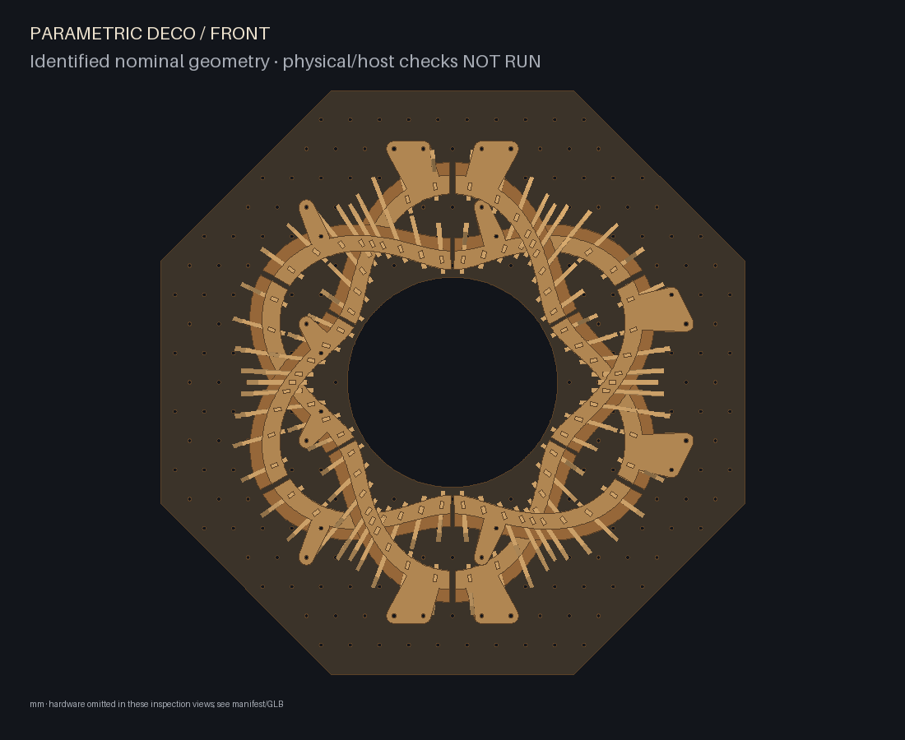
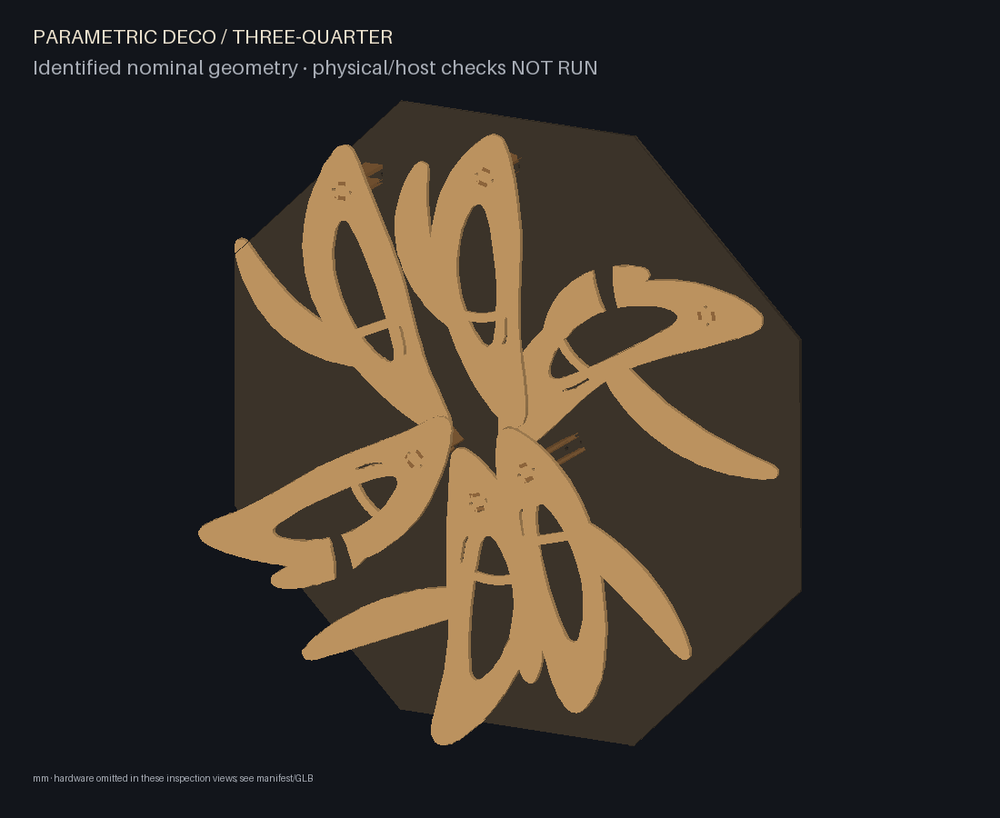
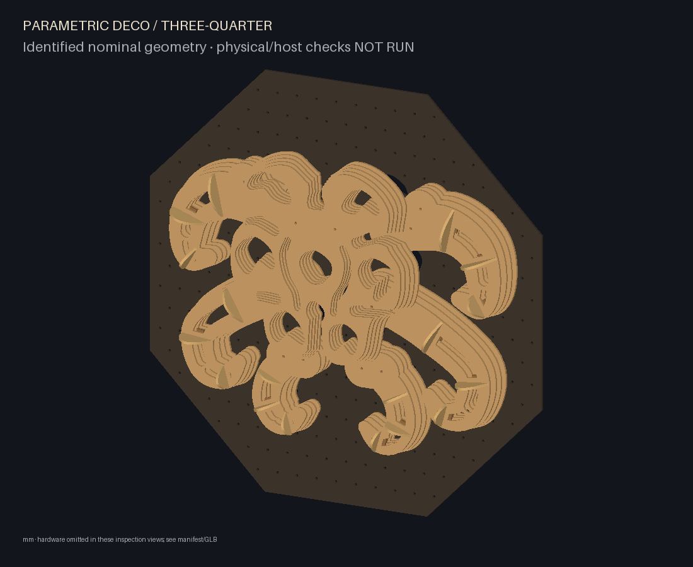
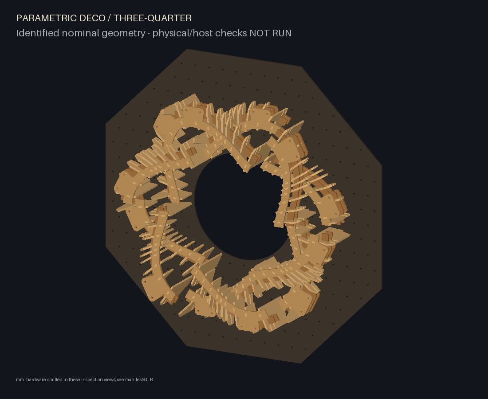

# Parametric Deco

Generate varied plywood relief sculptures from one configuration workflow.
Choose **laminar**, **layered-creature**, **radial-weave** or **rib-study**, then
adjust that style's parameters. Each style keeps its useful geometry and joinery;
all share immutable manufactured inventory, laser cuts, preview and projection
assets. Nominal plywood is 6 mm. Width, height and depth are independent requests;
manufacturing dimensions never scale with the artwork.

Python 3.11–3.13 is supported.

```sh
python -m venv .venv
. .venv/bin/activate
python -m pip install -r requirements.lock
python -m pip install --no-deps -e .
parametric-deco styles
parametric-deco init --style laminar --out my-design.json
parametric-deco build my-design.json --out build/my-design
parametric-deco preview build/my-design
parametric-deco visuals build/my-design --out build/my-visuals --visible-only
```

On Windows, activate with `.venv\Scripts\activate`. Open the localhost URL printed
by preview, drag to orbit, click to identify, and inspect the exploded assembly.
Edit `style`, its `parameters`, and shared manufacturing settings in JSON. The
[design guide](docs/design.md) covers every parameter, limits, curated examples,
actual CAD gallery, schema-v2 rewrite instructions and inventory reuse.

The optional [desktop editor](docs/implementation/desktop.md) exposes every
parameter, regenerates validated CAD automatically, and keeps an orbitable preview
visible while you tune a design. Install with `python -m pip install -e ".[gui]"`,
then run `parametric-deco gui` (or `parametric-deco-gui`).

Same two orthographic cameras, materials and fit-to-frame policy for all three
representatives; actual generated CAD with manufactured polygon backplates. Front is straight onto the XY board plane from +Z; three-quarter shows the relief. Hardware is omitted in these images.

| View | Laminar · `organism-low` | Layered creature · `creature-alien-six` | Radial weave · `radial-weave` |
| --- | --- | --- | --- |
| Front |  |  |  |
| Three-quarter |  |  |  |

Build exports SVG cuts, quantities, fit coupon, scale check, immutable inventory,
identified GLB/JSON, offline viewer, inspection images, assembly instructions and
validation report. `reconfigure CONFIG --inventory SAVED --out DIRECTORY` reuses
manufactured cuts at supported placements. Changing geometry requires new cuts;
old saved parts are never resized. Earlier laminar framework and creature anatomical-board inventories require new cuts for the common polygon board revision. The default laminar style supports identical
inventory replay; creature posture, radial and rib-study arrangements offer
bounded reuse. See the guide before choosing cuts.

This is a CAD and physical-test candidate, not a load-rated installation.
Physical fit, wear, stiffness, hardware/clip selection, detached handling and
anchorage are **NOT RUN**. Wire/Arena compilation, packaging and mapping are
**NOT RUN**. The project exports ISF/PNG resources and [manual host setup](docs/implementation/arena.md).

Technical references: [architecture](docs/software-architecture.md),
[fabrication](docs/implementation/fabrication.md), [joint mechanics](docs/implementation/joint-mechanism.md),
[visual data](docs/implementation/visual-data.md), [validation](docs/implementation/validation-status.md).

```sh
python -m pytest -q -rs
python -m ruff check .
python tests/run_examples.py
```

One complete implementation review is required by AGENTS.md. The owner has not
selected a project-wide licence; dependencies retain their upstream licences.
