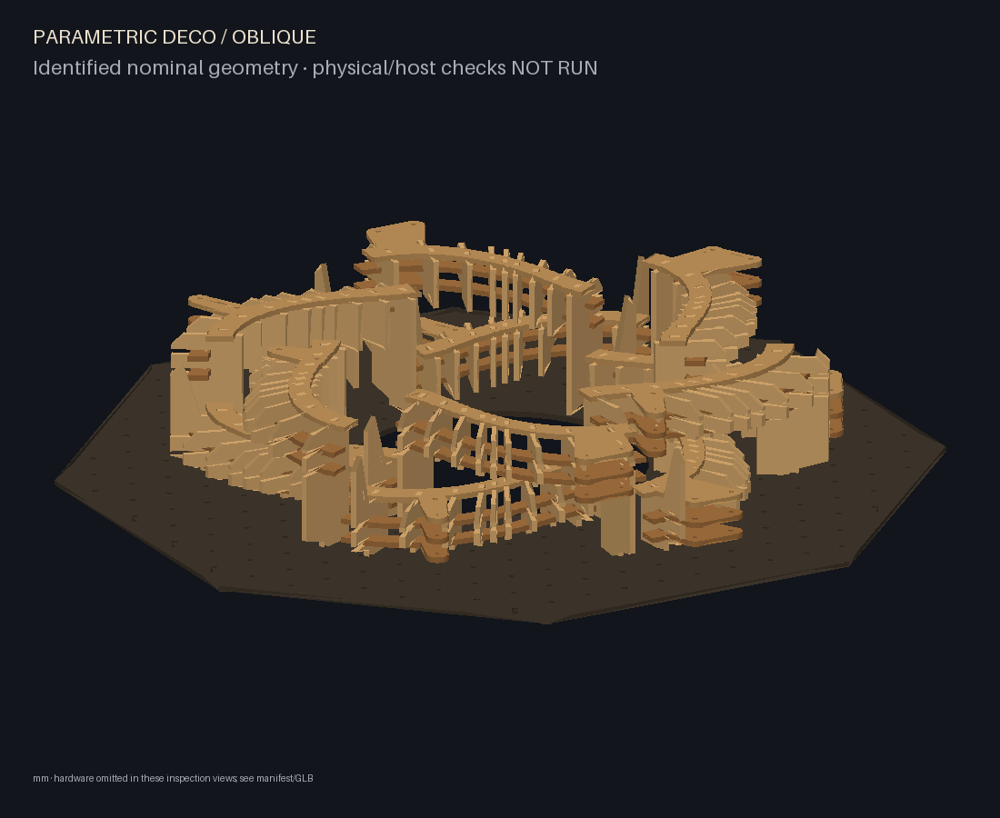
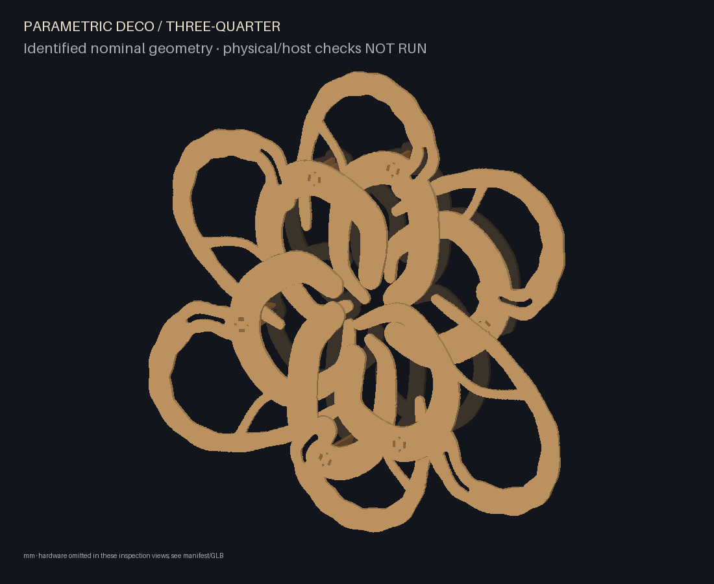
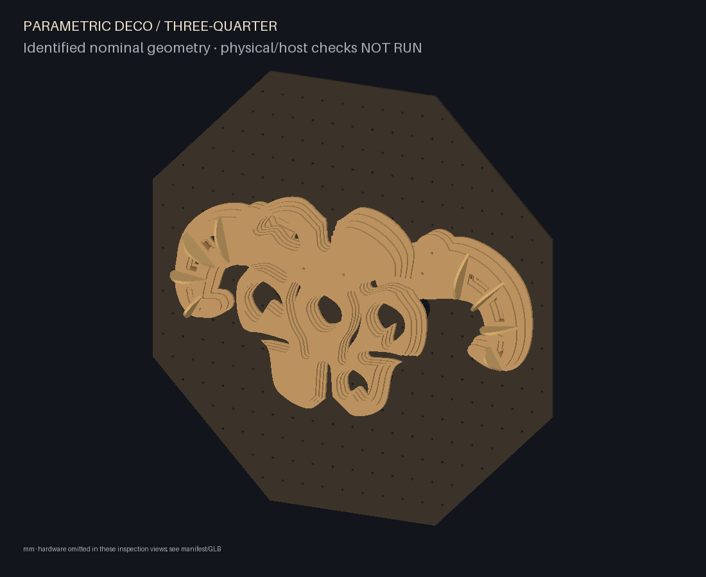
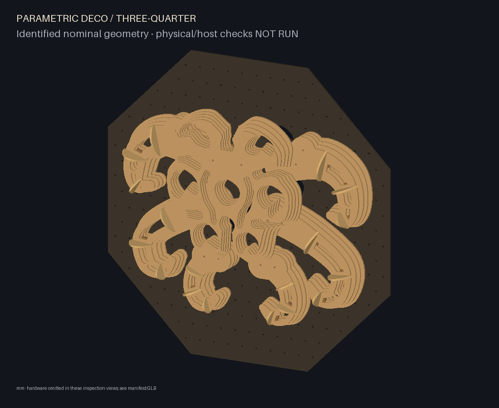
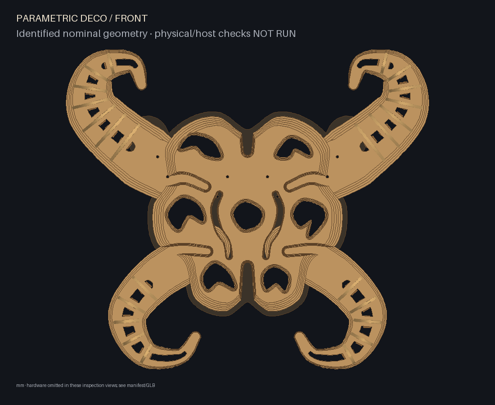
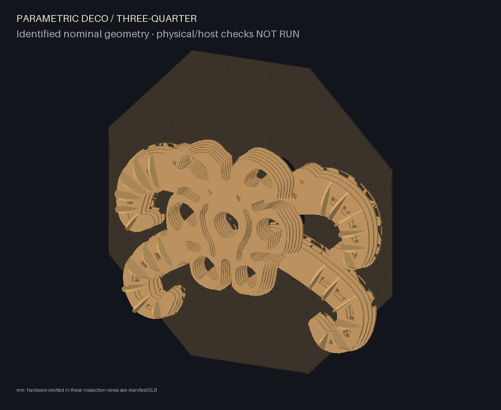
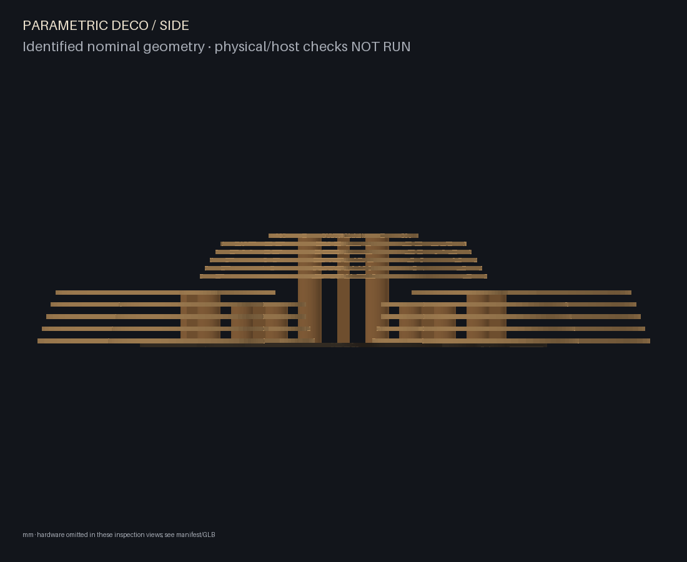
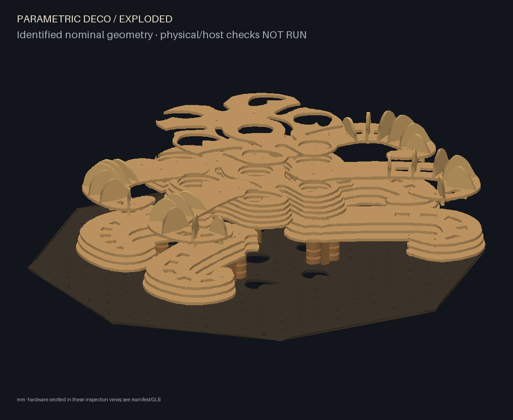

# Parametric Deco

A Python CAD prototype for one reconfigurable plywood sculpture, with immutable
part inventory, laser contours, identified assembly geometry and face-atlas ISF
resources for Resolume Wire/Arena.

The default envelope is 1,000 × 1,000 × 200 mm including backing, rear clearance
and hardware. Nominal plywood is 6 mm. Grade/finish are optional; white paint is
not required. Dimensions do not scale stock thickness, holes or slot clearance.

## Run

Python 3.11–3.13 is supported; validation used Python 3.12.14 and a clean Python 3.11.17 environment.

```sh
python -m venv .venv
. .venv/bin/activate
python -m pip install -r requirements.lock
python -m pip install --no-deps -e .
parametric-deco validate examples/single-module.json
parametric-deco build examples/intertwined.json --out build/intertwined
parametric-deco preview build/intertwined
parametric-deco visuals build/intertwined --out build/visuals
parametric-deco reconfigure examples/reconfigured.json --inventory build/intertwined/inventory.json --out build/reconfigured
python -m pytest -q -rs
python -m ruff check .
```

On Windows, activate with `.venv\Scripts\activate`. See [all CLI examples](docs/implementation/cli.md).

Outputs: individual nominal SVGs and quantity manifest, fit coupon, scale check,
assembly/inventory JSON, named GLB (metres), offline orbit/identify/explode viewer,
front/oblique/side/section/exploded PNGs, validation report, and numbered assembly/removal
instructions. An optional cutting bed enables conservative shelf placement;
oversized parts fail rather than shrink. Unknown bed size gives individual cuts.

The new [radial weave](docs/implementation/radial-weave.md) is the digital artwork
candidate: two curved paths, a 360 mm central opening, twelve removable modules
and six alternating over/under crossings. Build `examples/radial-weave.json`;
use `examples/radial-weave-reconfigured.json` with its saved inventory for the
second arrangement. The earlier `examples/intertwined.json` remains a mechanical
study. Physical and host validation gates remain open.

Reconfiguration uses immutable manufactured definitions and explicit physical
instance assignments; the example exchanges compatible ribs between modules.
Default atlases select broad faces before packing and allocate pixels according
to physical size. Optional exterior/all-face or explicit selections are available.



## Flow organism family

The current [flow organism generator](docs/implementation/flow-organism.md) replaces
this PR's mask direction with overlapping branching lobes, ambiguous focal chambers
and actual relief. Composition, complexity, requested millimetre sizes and style are
separate controls. The low production study has 19 plywood pieces, without spacer
rings or individual retaining clips; medium/high have 37. Digital examples cover
800, 1000 and 1400 mm widths, three complexities and two different focal layouts.
Physical and Wire/Arena validation remain NOT RUN.

```sh
parametric-deco build examples/organism-low.json --out build/organism-low
parametric-deco preview build/organism-low
python scripts/organism_examples.py
```



## Legacy parametric alien studies


The [alien family](docs/implementation/creature-mask.md) generates different decos
from numeric controls. The default has **four total limbs**, sweeping sideways
and folding down, plus six unequal cavities. Set `creature.limb_count` (2–6),
`cavity_count` (3–8), `ribs_per_limb` (3–7), `shell_layers`, `limb_layers`,
`limb_reach`, `limb_width`, `rib_height_mm`, `asymmetry`, `scale` and `curl` in JSON.
See the [parameter table and limits](docs/implementation/creature-mask.md#parameters).
These controls change actual laser-cut parts, modules and connections.

Three supplied examples demonstrate **different cuts**, not inventory reuse:
`creature-alien-two.json`, `creature-mask.json` (four limbs) and
`creature-alien-six.json`. Family `creature-organism-v3` rejects earlier inventories.
Within an unchanged recipe, rest/raised poses reuse all manufactured parts.
The radial weave remains supported independently. Real clips, fits and strength
still need prototyping; detached stacks require tray support and compression.

```sh
parametric-deco build examples/creature-mask.json --out build/creature-mask
parametric-deco reconfigure examples/creature-mask-raised.json --inventory build/creature-mask/inventory.json --out build/creature-mask-raised
parametric-deco visuals build/creature-mask --out build/creature-mask-visuals --visible-only
parametric-deco build examples/creature-alien-two.json --out build/creature-alien-two
parametric-deco build examples/creature-alien-six.json --out build/creature-alien-six
```

| Two-limb variation | Six-limb variation |
| --- | --- |
|  |  |

### Inspect the 3D structure

These images come from the actual CAD. The three-quarter view shows transverse ribs
and stand-off from the backing; the exploded view separates lower plates from cap/rib subassemblies
for inspection (the offsets are illustrative, not assembly motion).

| Front silhouette | Three-quarter: depth and anatomy |
| --- | --- |
|  |  |

| Side: plate spacing | Exploded: internal structure |
| --- | --- |
|  |  |

For a **live rotatable view**, build the example using the command above, then run:

```sh
parametric-deco preview build/creature-mask
```

Open **http://127.0.0.1:8765/preview/** in your browser. Drag to rotate, scroll to
zoom, and click a part to identify it. Use **Explode** to separate the layers,
uncheck **Backplate** to inspect the webs and spacers, or expand **Part visibility**
to hide individual parts. **Front**, **Side** and **Perspective** reset the angle.
Stop the local server with Ctrl+C. The viewer is bundled with each build and needs
no external JavaScript service; GitHub's README itself cannot run it.

You can also open the generated `build/creature-mask/assembly.glb` in a GLB-capable
3D viewer. Hardware in the browser preview is a simplified clearance envelope.

## Validation boundary

This is a **software prototype and physical-test candidate**, not a load-rated
installation. A real full-length top closure blocks sampled rib withdrawals and
is clamped to the backing by two long root bolts per module. Detached modules
require a support tray and hand compression. Read the [joint sequence](docs/implementation/joint-mechanism.md)
before cutting or handling anything.

Physical fit, wear, stiffness, root hardware selection, wall anchorage and
projection trials are **NOT RUN**. Wire/Arena are unavailable here: actual shader
compilation, patch packaging, resource relocation and mapping are **NOT RUN**.
The repository supplies ISF/PNG resources and [manual host setup](docs/implementation/arena.md),
not an invented Wire patch or Arena preset. Geometric mapping belongs in Arena
and is applied once. [Validation evidence and outstanding checks](docs/implementation/validation-status.md).

## Documentation

- [Requirements](docs/requirements.md), [decisions](docs/decisions.md), [mechanical concept](docs/mechanical-design.md).
- [Architecture](docs/software-architecture.md), [prototype tests](docs/prototype-validation.md), [roadmap](docs/roadmap.md).
- [Implementation plan](docs/superpowers/plans/2026-10-27-parametric-deco-implementation.md) and [execution ledger](docs/implementation/progress.md).
- [CAD backend](docs/implementation/backend.md), [backplate](docs/implementation/backplate.md), [fabrication](docs/implementation/fabrication.md).
- [Reconfiguration](docs/implementation/reconfiguration.md), [visual data](docs/implementation/visual-data.md), [host feedback](integrations/resolume/host-feedback.md), [physical feedback](docs/implementation/physical-feedback.md).

AGENTS.md requires one whole-implementation review at the end, without task-by-task
review rounds. No standalone VJ engine, structural solver, automatic calibration
or generalized nesting optimizer is included. The owner has not selected a
project-wide licence; runtime dependencies retain their upstream licences.
