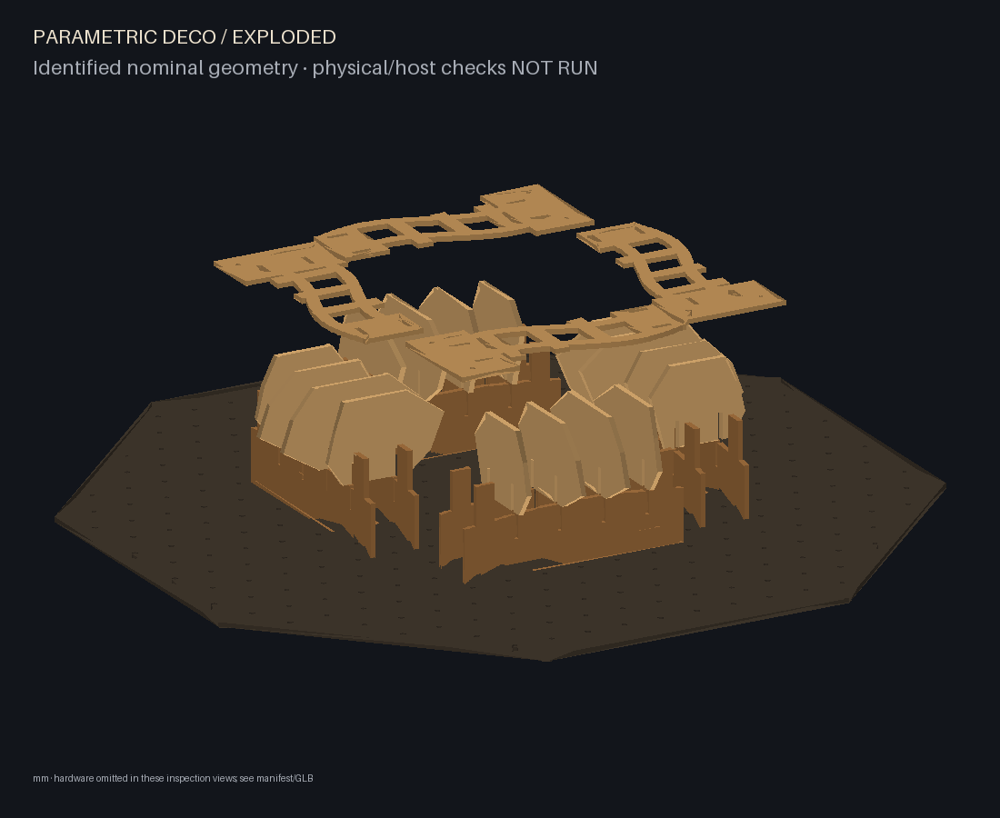

# Parametric Deco

A Python CAD prototype for one reconfigurable plywood sculpture, with immutable
part inventory, laser contours, identified assembly geometry and face-atlas ISF
resources for Resolume Wire/Arena.

The default envelope is 1,000 × 1,000 × 200 mm including backing, rear clearance
and hardware. Nominal plywood is 6 mm. Grade/finish are optional; white paint is
not required. Dimensions do not scale stock thickness, holes or slot clearance.

## Run

Python 3.11–3.13 is supported; validation used Python 3.12.14 and a clean Python 3.11.17 environment.

```sh
python -m venv .venv
. .venv/bin/activate
python -m pip install -r requirements.lock
python -m pip install --no-deps -e .
parametric-deco validate examples/single-module.json
parametric-deco build examples/intertwined.json --out build/intertwined
parametric-deco preview build/intertwined
parametric-deco visuals build/intertwined --out build/visuals
parametric-deco reconfigure examples/reconfigured.json --inventory build/intertwined/inventory.json --out build/reconfigured
python -m pytest -q -rs
python -m ruff check .
```

On Windows, activate with `.venv\Scripts\activate`. See [all CLI examples](docs/implementation/cli.md).

Outputs: individual nominal SVGs and quantity manifest, fit coupon, scale check,
assembly/inventory JSON, named GLB (metres), offline orbit/identify/explode viewer,
front/side/section/exploded PNGs, validation report, and numbered assembly/removal
instructions. An optional cutting bed enables conservative shelf placement;
oversized parts fail rather than shrink. Unknown bed size gives individual cuts.

The intertwined example is a coordinated four-module whorl on one octagonal
staggered-grid backplate. Reconfiguration changes the rib arrangement using the
same manufactured definitions and identified physical instances. Natural/coloured
or neon finish remain optional. Global effect paths cross mechanical boundaries.



## Validation boundary

This is a **software prototype and physical-test candidate**, not a load-rated
installation. A real full-length top closure blocks sampled rib withdrawals and
is clamped to the backing by two long root bolts per module. Detached modules
require a support tray and hand compression. Read the [joint sequence](docs/implementation/joint-mechanism.md)
before cutting or handling anything.

Physical fit, wear, stiffness, root hardware selection, wall anchorage and
projection trials are **NOT RUN**. Wire/Arena are unavailable here: actual shader
compilation, patch packaging, resource relocation and mapping are **NOT RUN**.
The repository supplies ISF/PNG resources and [manual host setup](docs/implementation/arena.md),
not an invented Wire patch or Arena preset. Geometric mapping belongs in Arena
and is applied once. [Validation evidence and outstanding checks](docs/implementation/validation-status.md).

## Documentation

- [Requirements](docs/requirements.md), [decisions](docs/decisions.md), [mechanical concept](docs/mechanical-design.md).
- [Architecture](docs/software-architecture.md), [prototype tests](docs/prototype-validation.md), [roadmap](docs/roadmap.md).
- [Implementation plan](docs/superpowers/plans/2026-10-27-parametric-deco-implementation.md) and [execution ledger](docs/implementation/progress.md).
- [CAD backend](docs/implementation/backend.md), [backplate](docs/implementation/backplate.md), [fabrication](docs/implementation/fabrication.md).
- [Reconfiguration](docs/implementation/reconfiguration.md), [visual data](docs/implementation/visual-data.md), [host feedback](integrations/resolume/host-feedback.md), [physical feedback](docs/implementation/physical-feedback.md).

AGENTS.md requires one whole-implementation review at the end, without task-by-task
review rounds. No standalone VJ engine, structural solver, automatic calibration
or generalized nesting optimizer is included. The owner has not selected a
project-wide licence; runtime dependencies retain their upstream licences.
