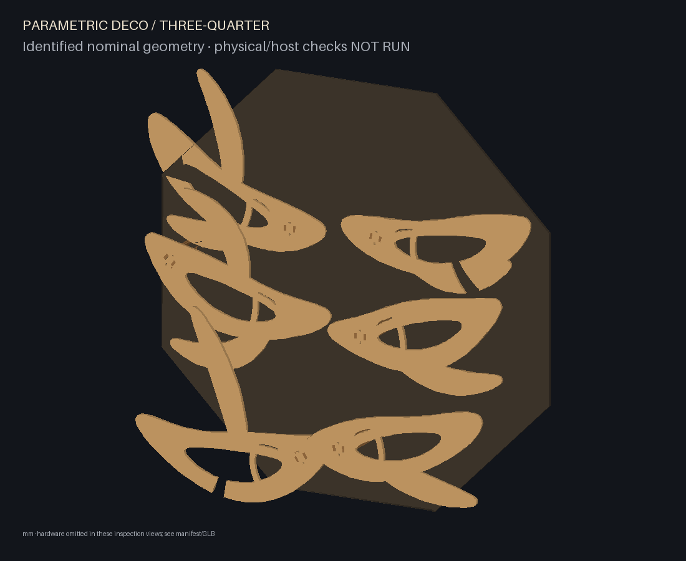
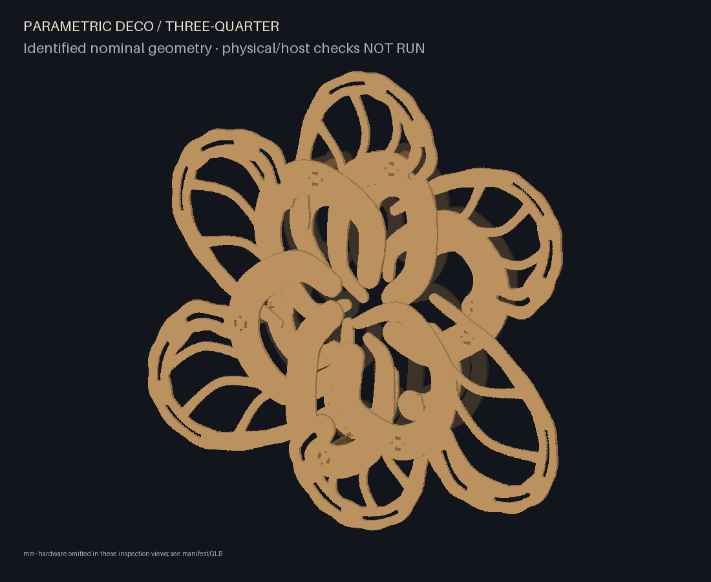

# Unified design workflow

Choose a style, vary its parameters, then generate or place saved inventory.
Laminar is the default artwork; layered creature, radial weave and rib study
retain useful different geometry and joinery behind the same public workflow.

## Generate and explore

```sh
parametric-deco styles
parametric-deco init --style laminar --out my-design.json
parametric-deco validate my-design.json
parametric-deco build my-design.json --out build/my-design
parametric-deco preview build/my-design
parametric-deco visuals build/my-design --out build/my-visuals --visible-only
```

`styles` prints each style and its complete default parameter object. `init`
writes a complete, editable configuration and refuses to overwrite an existing
file. Build and visuals refuse overwrite unless `--force` is explicit. All styles
use the same commands and export pipeline. `validate` constructs and checks CAD;
it is more than a JSON syntax check. A build writes nominal SVG cuts and quantity
manifest, fit coupon, scale check, inventory/assembly JSON, named GLB (metres),
offline preview, inspection PNGs, assembly/removal instructions and validation.

Minimal v2 configuration (also the meaning of `{}`):

```json
{"schema_version": 2, "style": "laminar", "parameters": {}}
```

Only the chosen style's parameters are accepted. Unknown fields and mixed style
controls fail. Counts require integers, not booleans or `4.0`. Numeric geometry
controls must be finite. Documented ranges bound exploration; not every combination
passes manufacturing geometry, clearances, root bearing, collisions and removal.
A failure is reported rather than deleting requested limbs, clipping contours or
scaling joints to fit. Change several independent controls to explore different
anatomy; changing only a complexity number is not the full design space.

| Style | Geometry and useful variation | Curated examples |
| --- | --- | --- |
| `laminar` (default) | Divergent laminae, eccentric chambers, daughter branches and varied relief; composition, local anatomy, complexity and millimetre size are separate controls | `organism-low`, `organism-medium`, `organism-high`, `organism-bilateral`, `organism-small`, `organism-large` |
| `layered-creature` | Layered shell and ribbed lateral/folded limbs; mask, armour or horn associations are valid alternate aesthetics. Counts, cavities, asymmetry, curl and rib/layer density change actual parts | `creature-alien-two`, `creature-mask`, `creature-alien-six`; `creature-mask-raised` reuses cuts |
| `radial-weave` | Two annular strands, six alternating crossings and a central aperture. Radius/amplitude/opening vary the braid; topology is deliberately bounded | `radial-weave`; `radial-weave-reconfigured` reuses cuts |
| `rib-study` | Straight paired-spine modules with selectable rib profiles, station spacing and explicit placements. Useful mechanical study, with fewer integrated composition controls | `single-module`, `intertwined`; `reconfigured` reuses cuts |

Examples are `.json` files under `examples/`. They are current supported requests,
not compatibility aliases. The former rejected curl/loop generator, concept-only
studies and superseded design/review ledgers have been removed; Git retains history.
Current geometry algorithms remain distinct adapters because they produce useful
different topologies and joinery. This change does not claim new topology or
certify artistic success from a numeric complexity score.

## Shared settings and dimensions

All lengths use millimetres. Envelope defaults to 1000 × 1000 × 200 including
backing, rear clearance and hardware. Width, height and depth are independent
requests; style feasibility still applies. Nominal plywood defaults to 6 mm,
`material.measured_mm` to 6, `clearance_mm` to 0.2. Measure stock and prototype fit;
resizing artwork never rescales holes, stock, clearance or washers. Kerf is applied
once by laser software. Grade and finish are optional; no white paint is required.

| Setting | Meaning and style boundary |
| --- | --- |
| `envelope` | Laminar fits XY (2 mm boundary allowance) and generates actual relief for depth; XY 800–1400, aspect ratio 0.7–1.4, depth 120–240. For the other styles this is a containment budget, not a scale command: creature geometry uses its explicit scale/reach controls; radial uses millimetre radii; rib study uses recipe dimensions. Too small fails. |
| `material` | Nominal/measured thickness, measurement status (`assumed_unmeasured` or `measured`), fit clearance and optional grade/finish. Measured stock must remain within 1 mm of nominal. |
| `grid` | Pitch X/Y 50, alternate row offset 25, origins 0, bore diameter 6.5 and edge margin 15 by default. Staggered grid locates radial, creature and rib-study roots; laminar derives roots from anatomy and uses the bore diameter, not grid pitch. |
| `backplate` | Regular polygon sides 8 and rotation 22.5° for radial and rib study. Creature and laminar derive their own outlines; these polygon fields do not shape them. |
| `mounting` | Rear clearance 10, hardware outward allowance 12, washer radius 9; root half-span 50 (40–55) controls rib-study wings. Other styles derive root spacing. Hardware proxies are clearance envelopes. |
| `cutting_bed` | Optional width/height and spacing (default 5). Conservative rectangular shelf placement; oversized parts fail rather than shrink. Null gives individual cuts. |

## Laminar parameters

All rows below are inside `parameters` (except the explicit envelope rows).
| Group | JSON field | Default / range | Actual geometry effect |
| --- | --- | --- | --- |
| Composition | `parameters.arrangement` | `whorl`, `bilateral` | Orbiting focal field or staggered paired rows |
| Composition | `focal_count` | 6 / integers 4–8 | Number of primary focal/appendage modules |
| Composition | `branching` | 2 / integers 1–3 | Maximum daughter branches per region; the field varies actual counts |
| Composition | `anatomy_phase_deg` | 0 / −180–180 | Shifts regional open/closed cavity and branch relationships |
| Composition | `phase_deg` | 17 / −180–180 | Whorl orientation and relative phase of regional anatomy |
| Composition | `spread` | 1 / 0.85–1.15 | Relative focal spacing before fitting the silhouette |
| Composition | `symmetry` | `rotational`, `bilateral`, `none` | Repeated orientation, reflected local paths, or individually tilted forms |
| Complexity | `complexity` | 0 / integers 0–2 | Coordinated secondary lobes, segmentation and channels |
| Override | `secondary_lobes` | null / integers 0–1 | Null follows complexity; 1 adds an inner lobe per primary region |
| Override | `segmentation` | null / integers 0–5 | Integral curved divisions in each appendage, 1/2/3 by complexity |
| Override | `channels` | null / integers 0–3 | Longitudinal cut channels, 1/2/3 by complexity |
| Size | `envelope.width_mm`, `height_mm` | 1000 / 800–1400 | Generated composition size, with a 2 mm XY boundary allowance |
| Size | `envelope.depth_mm` | 200 / 120–240 | Actual relief and support heights; retains rear/hardware allowance |
| Style | `curvature` | 1 / 0.7–1.3 | Curvature over main paths, branches and divisions |
| Style | `taper` | 1 / 0.7–1.3 | Width distribution along paths |
| Style | `swelling` | 1 / 0.8–1.2 | Broadening and anatomical weight |
| Style | `angularity` | 0 / 0–0.6 | Continuous modulation of sweep radius along the path |
| Style | `asymmetry` | 0.12 / 0–0.2 | Controlled differences in reach, orientation and curvature |

Complexity 0/1/2 selects 1/2/3 internal divisions and channels, and optional inner
lobes; explicit overrides replace those defaults. Subdivision accumulates material
without changing the primary paths/layout; channels intentionally remove material.
Low uses 19 plywood pieces; medium/high 37. Complexity describes anatomical detail,
not assembly effort. Whorl/bilateral and anatomy phase give different focal layouts.
Each plate sits on two slotted trestles and two root bolts. No spacer rings or
individual rib retaining clips are required. Detached modules need a cradle.

## Layered-creature parameters

All fields are inside `parameters`.
| Parameter | Default | Range | Effect |
| --- | --- | --- | --- |
| `limb_count` |4| integer2–6 | Active complete appendage modules |
| `cavity_count` |6| integer3–8 | Primary recesses selected from the anatomical cavity palette |
| `ribs_per_limb` |6| integer3–7 | Transverse ribs, cap slots, keys and required clips on EVERY limb |
| `shell_layers` |6| integer3–6 | Central shell plates, root column height and web height |
| `limb_layers` |4| integer3–5 | Shell/rail plates per limb, spacer quantities and cap elevation |
| `limb_reach` |1.0|0.85–1.05| Path reach about fixed mounting roots |
| `limb_width` |1.0|0.9–1.1| Swelling shell/rail widths and rib widths |
| `rib_height_mm` |65|45–80 mm| Peak transverse-rib height, modulated along the limb |
| `asymmetry` |0.08|0–0.15| Controlled side differences in reach/width;0 mirrors the paths |
| `scale` |1.0|0.9–1.0| XY profile AND transverse rib-height scale; roots/stock/joinery retain physical sizes |
| `curl` |1.0|0.8–1.2| Terminal fold position |
| `posture` |`rest`|`rest`, `raised_crown`| Placement of an unchanged manufactured inventory |

`scale` affects XY profiles and transverse rib height, with fixed roots and
joinery. It is not independent Z sizing; `rib_height_mm` is the local relief
control and envelope depth remains a budget. Layer counts also affect actual Z.
Examples vary two/four/six limbs and four/six/eight cavities. The finite cavity
palette and six root/path recipes are bounded style choices. Denser combinations
can fail slot ligaments or collisions. There is no artificial "laminar-only"
artistic restriction on this style.

This style has substantial assembly effort: default 179 plywood pieces, 98 spacer
rings and 24 rib retaining keys/clips. Each cap/rib/key subassembly is serviced
upside down in a padded cradle. A headed key crosses a tab window; a positive
split pin/clip stop is REQUIRED against reverse withdrawal. Hardware selection,
clip security and access remain NOT RUN. It is retained for its distinctive
layered relief, not presented as the simplest build.

## Radial-weave parameters

| Parameter | Default / range | Effect |
| --- | --- | --- |
| `radius_mm` | 300 / 250–340 | Mean strand radius |
| `amplitude_mm` | 65 / 40–80 | Alternating radial excursion; paths follow R ± A sin(3θ) |
| `opening_radius_mm` | 180 / positive, ≤ radius − amplitude − 52 | Backing aperture clearing manufactured inner fins/root pads |
| `lobes` | 3 only | Fixed six-crossing topology; other counts fail |
| `ribs_per_module` | 9 only | Fixed stations/joint topology; other counts fail |
| `rotation_deg` | 0 / finite | Arrangement rotation; compatible roots must still match saved grid holes |
| `rib_permutation` | [0,1,2,3,4,5,6,7,8] | Integer permutation of central stations 2–6 only; 0,1,7,8 stay fixed |

Twelve curved modules contain 108 fins, 24 spines and twelve capture rails. Default
hardware-inclusive depth is 186 mm. Capture rails block inward fin withdrawal;
remove rails before sliding fins inward. Sampled dependencies require high
modules before the corresponding low modules. Larger requested envelope depth
does not inflate the manufactured relief.

## Rib-study parameters

`parameters.recipe` contains `length_mm` 300, `spine_separation_mm` 60,
`spine_height_mm` 80, `joint_datum_mm` 45, `rib_top_mm` 116,
`rib_bottom_mm` 10, `stations_mm` [70,130,190,250] and
`rib_widths_mm` [130,160,190,160]. Require bottom < datum < spine height < rib top;
stations are ascending and unique with root/end margins (55 mm from root,
15 mm from end) and stock+clearance+10 mm between stations. Rib widths require
one per station, at least separation+30 mm; paired slots require separation of
at least four times stock+clearance. Actual CAD checks still apply.

`parameters.placements` is a list with `module_id`, `x_mm`, `y_mm`, `angle_deg`,
`rib_order`, `station_indices`; see `intertwined.json` and `reconfigured.json`.
At least three unique ribs/stations per module are required. Optional
`spine_instance_ids` (two), `closure_instance_id` and `rib_instance_ids` explicitly
assign physical inventory parts; these require `reconfigure`. The full upper
closure blocks sampled upward rib withdrawals and is clamped by two root bolts.
See [joint mechanics](implementation/joint-mechanism.md).

## Manufacturing and saved inventory

`build` generates new cuts. `reconfigure` requires a manufactured inventory:

```sh
parametric-deco build examples/creature-mask.json --out build/creature
parametric-deco reconfigure examples/creature-mask-raised.json --inventory build/creature/inventory.json --out build/raised
parametric-deco visuals build/raised --out build/raised-visuals --visible-only
```

Changing style requires new cuts. For laminar, changing anatomy, complexity, size,
stock or mounting requires new cuts; saved inventory supports identical replay.
Creature permits `posture` changes on unchanged cuts; all manufacturing controls
must match. Radial permits compatible rotation/fin permutation; radius, amplitude,
stock/backing/mounting changes require new cuts. Rib study places actual saved
interfaces and profiles: its current recipe does not resize inventory, so use
placements/physical assignments to rearrange manufactured parts.

Public generation schema is now **2**; schema-1 requests and old top-level
`organism`, `creature`, `composition`, `module` and `placements` fail with a rewrite
instruction. To rewrite a request, select laminar/creature/radial respectively and
move that object's fields into `parameters`; for rib study move `module` into
`parameters.recipe` and `placements` into `parameters.placements`. Then validate
as a new request. No automatic historical generation migration is promised.

Inventory schema and geometry identity remain unchanged: laminar-organism-v2,
creature-organism-v3, radial-weave-v1 and existing rib definitions. The creature
adapter preserves its previous manufacturing hash field set. New-schema replay
uses saved cuts; it never regenerates stock or rewrites an old contour. Earlier
rejected families still fail; semantic names are not geometry compatibility.
`examples/inventory.json` is a manufactured fixture and is retained unchanged.

## Actual CAD gallery

These views are rendered from supported generated contours, not illustrative
artwork. They remain accurate because this cleanup leaves geometry algorithms
unchanged. Hardware in previews is simplified; image framing fits each artwork.

| Laminar low | Laminar bilateral | Laminar high |
| --- | --- | --- |
|  |  |  |

| Creature two limbs | Creature six limbs | Radial weave |
| --- | --- | --- |
|  |  |  |

For manufacturing inspection, each build exports front, side, oblique,
three-quarter, exploded and joint-section views. The offline viewer supports
orbit, identify, visibility and explode controls using the same assembly.

## Validation boundary

Digital checks cover connected planar cuts, style-specific ligaments and bearing,
static interference, hardware corridors, envelope and sampled withdrawal paths.
They do not establish strength, continuous motion or aesthetic success. Physical
fit, wear, stiffness, fastener/clip selection, detached handling and wall anchorage
are **NOT RUN**. Wire/Arena compilation, packaging, relocation and projection
mapping are **NOT RUN**. Resources are ISF/PNG plus [manual host setup](implementation/arena.md),
not a fabricated Wire patch or Arena preset. Apply mapping once in Arena.
