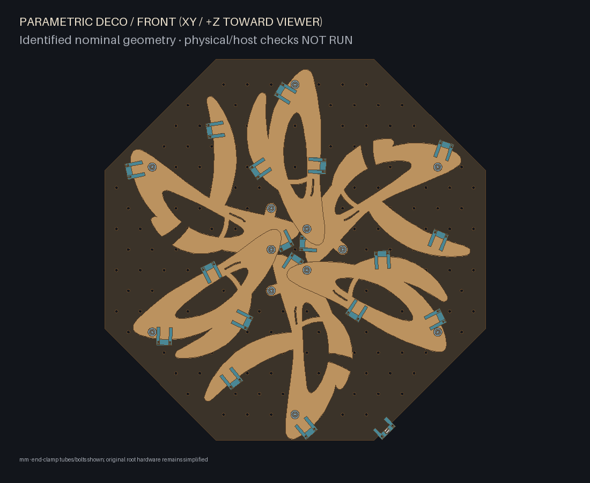
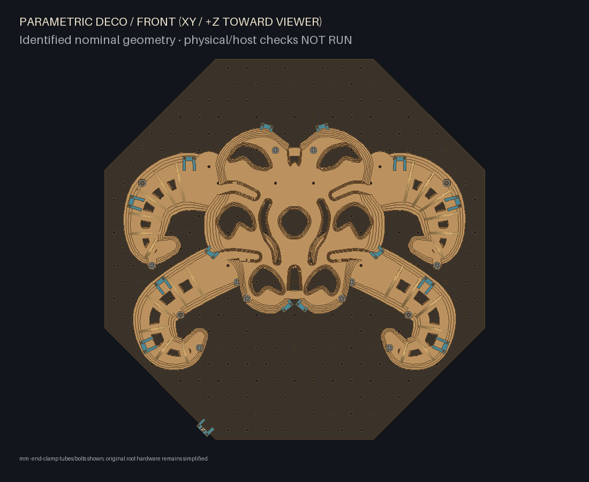
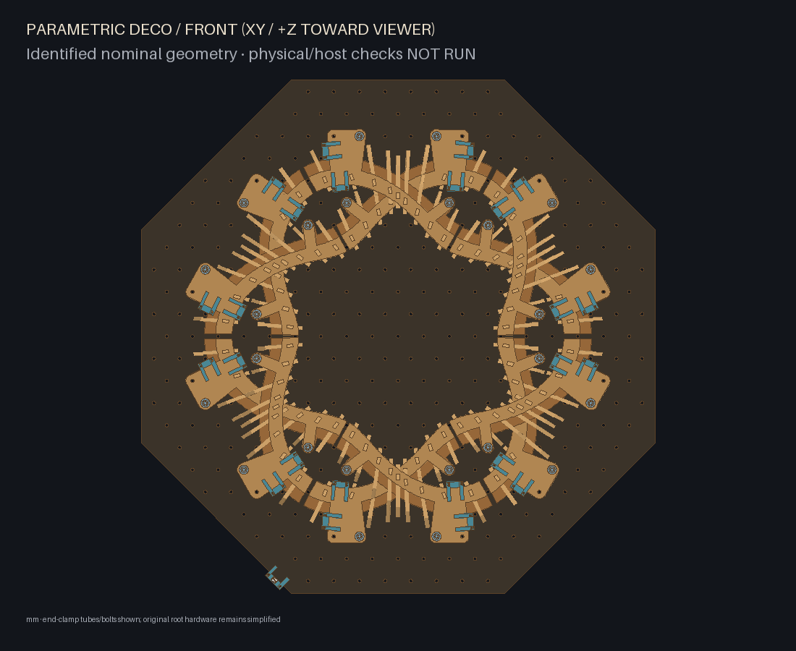
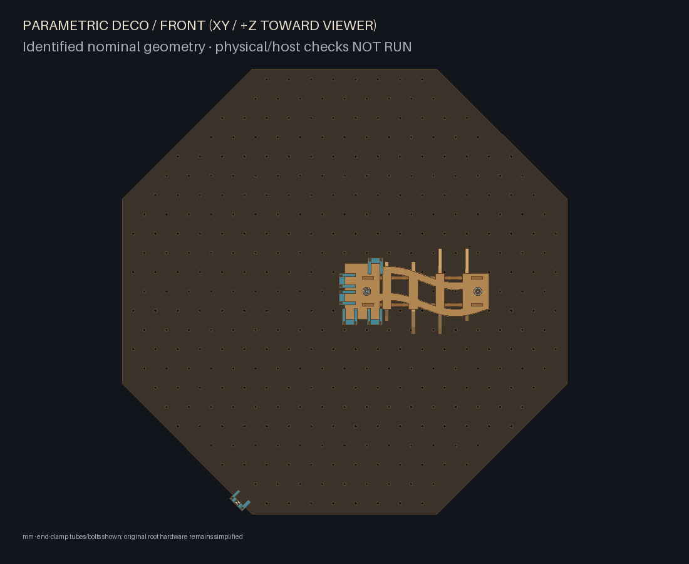
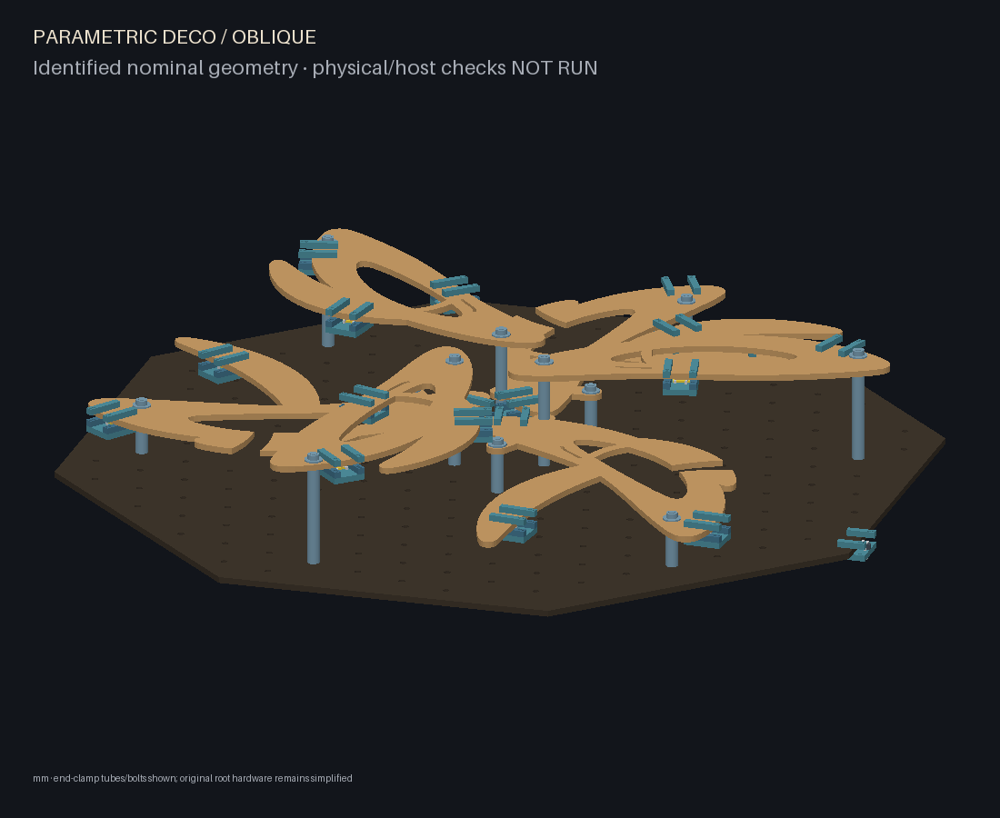
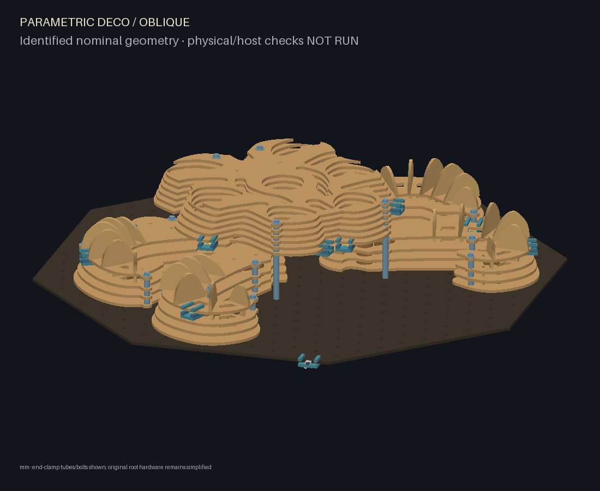
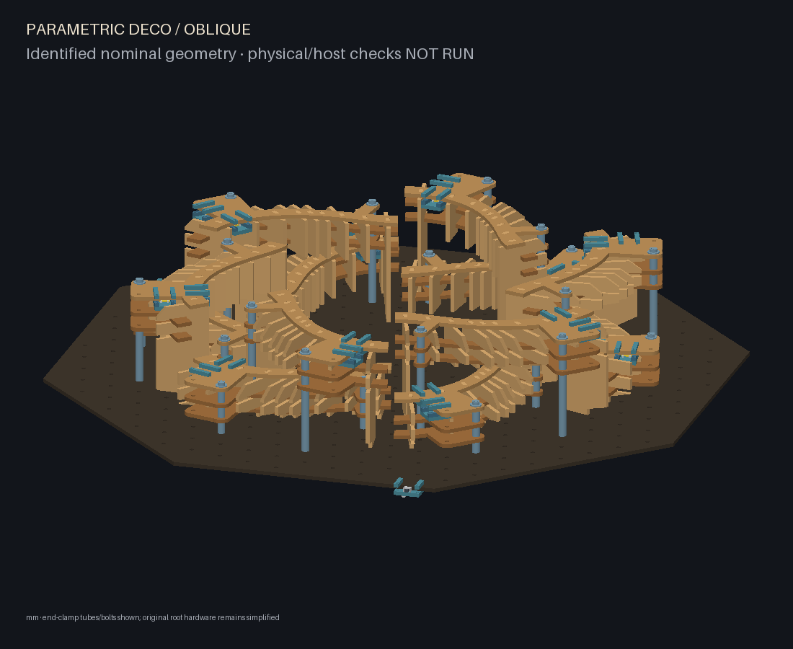
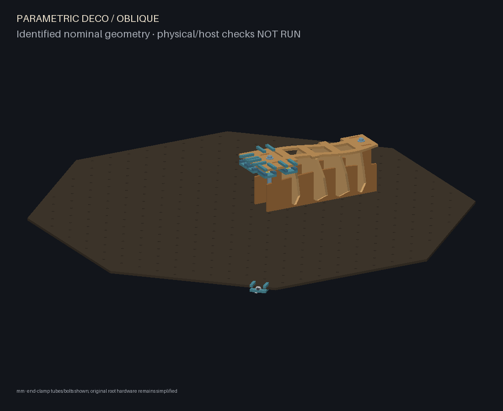
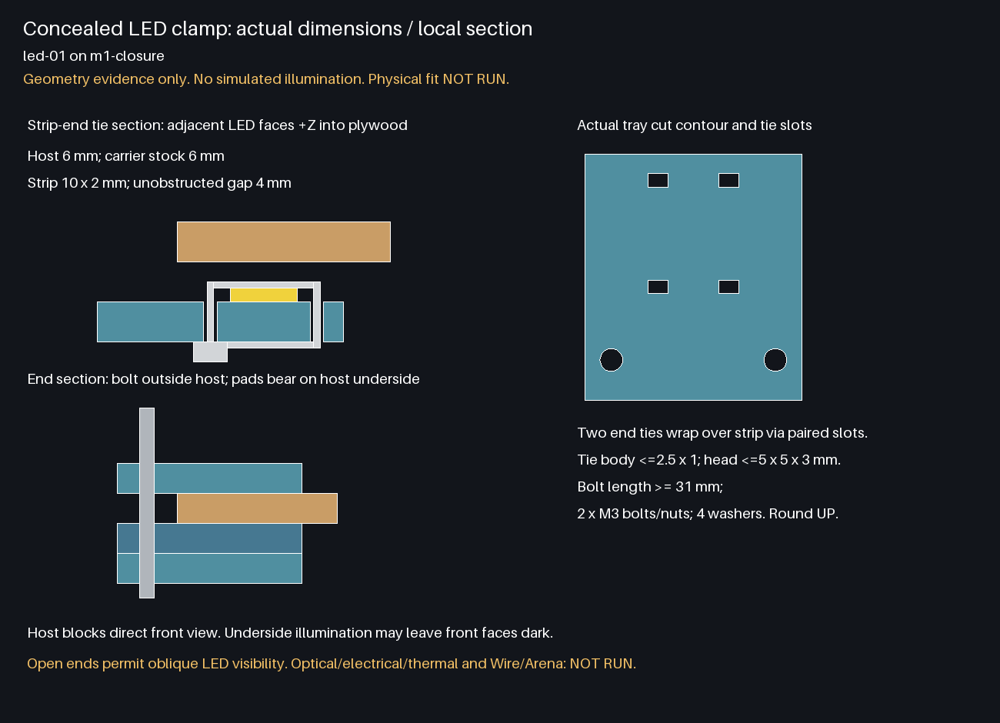
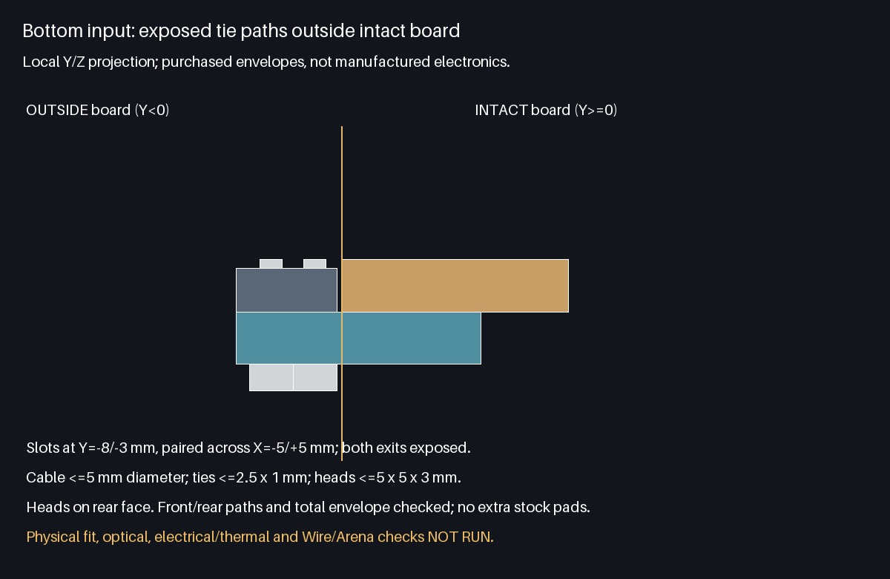

# Optional concealed addressable strip mounting

Lighting runs after the latest universal-grid `supported_build`; it checks the
actual machined contours and modeled end-support hardware, then attaches its
independent immutable inventory supplement. The shared `lighting` object is default-off for every schema-v2 style. Existing
base part polygons, revisions, joints and backing holes remain unchanged.
Enable it in JSON, or expand `lighting` in the desktop parameter tree, edit
`enabled` to `true`, and validate/preview/export as usual. Opening an old JSON
request fills shared defaults in the tree. The desktop JSON editor exposes the
same controls. Its tree overlays JSON-compatible defaults while preserving raw
invalid fields, so tuple-backed array settings remain editable lists and a bad
value can be corrected in the tree. Preview/export still require validation. No separate lighting-only generation mode is necessary.

```sh
PYTHONPATH=src python -m parametric_deco.cli build examples/laminar-led.json --out build/laminar-led
PYTHONPATH=src python -m parametric_deco.cli build examples/layered-creature-led.json --out build/layered-creature-led
PYTHONPATH=src python -m parametric_deco.cli build examples/radial-weave-led.json --out build/radial-weave-led
PYTHONPATH=src python -m parametric_deco.cli build examples/rib-study-led.json --out build/rib-study-led
```

| Setting | Default | Meaning |
| --- | ---: | --- |
| enabled | false | Add removable carrier cuts and wiring metadata |
| strip_width_mm | 10 | Actual purchased strip width |
| strip_thickness_mm | 2 | Total backing/component height |
| led_pitch_mm | 16.666667 | Length per addressable cut unit |
| clearance_mm | 0.5 | Minimum footprint shielding margin and vertical gap |
| segment_leds | 1 | Addressable cut units per carrier, integer 1–20 |
| max_segments | 12 | Requested density ceiling, integer 2–64; must cover all modules |
| voltage_v | 5 | Purchased strip voltage: 5, 12 or 24 |
| current_per_led_ma | 60 | User supplied worst-case current per cut unit |
| injection_limit_a | 2 | Estimated maximum per internal power group |
| wire_slack_mm | 50 | Added to straight-line jumper/feed distance |

All numeric settings must be finite and positive. Enabled segments must be at
least 12 mm long to accommodate both retaining ties. For 12/24 V grouped strips,
count and pitch refer to the addressable CUT UNIT; set its actual current.
Manufactured stock thickness must accommodate strip thickness + 1 mm tie body
+ requested clearance (6 mm stock / 0.5 mm clearance permits <=4.5 mm strip).
The strip's real cut interval and component/tie locations still require checking.
Long segments and wide strips must fit, otherwise generation fails with a module
and an actionable sizing/geometry message. Small envelopes may have no supported
mounts; the generator rejects these rather than silently omitting lighting.

## Mechanical architecture and placement

`assembly.assemble(config, inventory=None)` wraps universal supported assembly with
`lighting.prepare_inventory` and `lighting.add_lighting`. `Assembly.lighting` is
optional and omitted from unlit serialized assemblies. There is no edit to base
manufactured geometry. `PartDefinition` and `PartInstance` describe every carrier,
pad and jaw; normal cut SVGs, sheet layout, meshes and inventory include these
same definitions/poses. The GLB/preview also shows clearly separate purchased
strip proxies, which never enter cut lists or manufactured inventory.

Each removable carrier has five plywood parts, all in the measured stock:
a rear tray, two end bearing pads and two front jaws. Two outside-edge M3 bolts
compress the jaws/pads onto the existing host edge without drilling it. Two
reusable ties pass through paired 3 x 2 mm tray slots and hold the strip against
the tray. Extra 3 x 2 mm jaw slots retain short cable service loops. Supported ties have
body <=2.5 x 1 mm and locking head <=5 x 5 x 3 mm, with heads behind the tray.
Full upper/rear returns, through-slot legs and heads are checked as purchased
envelopes against real wood/obstacles and total envelope; previews show them. M3 holes are
3.4 mm nominal; washers must have OD <=7 mm. Bolt lengths round UP to 5 mm steps,
including a 7 mm nut/washer/thread allowance, with rear-to-front insertion.
Conservative 7 mm diameter hardware envelopes are checked and exported; they
are not detailed fastener CAD. Prototype tightening/engagement before use.

The carrier tray is two stock thicknesses behind the host; rear pads occupy one
stock thickness. The strip sits on the tray face one stock thickness behind the
host, with emission +Z onto its underside. Entire strip footprint plus configured
margin must lie inside intact plywood, including avoiding cut holes. The empty
strip/emission corridor and real clamp solids must clear other artwork and root
hardware proxies. Clamp bearing on both ends is checked. Carrier/bolt envelope
bounds must fit the total envelope; normal sheet packing enforces cutting bed.

Only actual horizontal sculptural faces are supported: laminar lobe plates,
creature armour/caps, radial capture rails/spines, and rib-study closures. One
feasible clamp is required on every sculptural module. Additional separated carriers are selected in repeated module passes until
`max_segments` is reached or all feasible candidates are exhausted. At least two
carriers are required, including for the single-module rib study. This
spreads placement through the artwork instead of putting light on the backplate.
Perimeter search is deterministic at 600 samples per host. Larger segment spans
can hit standing fins: the one-unit default is intentional for radial-weave.
Base symmetry is preserved by leaving existing parts unchanged. Laminar C3 and
bilateral designs and mirrored creatures add complete physical carrier orbits
using the same symmetry mappings as the universal mounts. Every orbit member
is checked against its actual host and obstacles. The single bottom input is
intentionally exempt from sculptural symmetry. An incomplete orbit is rejected;
unused budget is reported rather than adding asymmetric leftovers.

Every segment exports its host, target, carrier frame, strip extents/start/end,
emission vector, emitter-to-host gap, shield margin and geometric checks. These
are geometric evidence, not measured optical performance. The host blocks direct
front sightlines, but open ends can expose emitters to oblique observers. This
lights plywood UNDERSIDES. Front faces may receive little/no direct illumination.
The CAD images are not simulated illumination and promise no brightness/uniformity.

## Single input, connections and BOM

A three-piece removable cable clamp grips the bottom backplate edge. Its four
2 x 3 mm slots lie outside intact board at Y=-8/-3 mm, paired at X=-5/+5 mm.
Two ties wrap an incoming <=5 mm diameter cable along Y; heads sit behind tray.
The full cable/tie/head paths clear the board without adding rear spacers, so
the default 10 mm rear clearance remains supported. A dedicated input section
shows this stack. Two ties provide strain relief for one external V+/DATA/GND cable and purchased inline
connector. Internal power feeds all originate from that same input. Deterministic
nearest-neighbour ordering links controller DATA to first DIN, then each DOUT to
next DIN. This data input is not a firmware programming port. Separate fused
power groups have explicit feed routes; V+ is omitted across group boundaries.

`lighting-routing.json` exports ordered segments, data pin semantics, jumpers,
input, branch feeds, estimated current/power, minimum wire lengths and validation
limits. Lines are manual harness guides with configured slack, not collision-free
wire solids. Dress and tie wires around joints and extraction paths; disconnect
modules before removal. `lighting-bom.json` lists purchased strip, bolts, nuts,
washers, reusable ties and external electrical requirements. `lighting-instructions.md`
contains assembly and electrical guidance with the Adafruit references. Input
connector required continuous current uses estimated total x1.25; this is a sizing
target and makes no claim about any unselected connector rating. Actual strip,
wire, connector, fuse, supply and controller data sheets govern selection.

## Immutable replay

A fingerprinted `lighting_supplement` lives alongside the original inventory
layout. The original style layout/fingerprint is unchanged inside it. Before
style replay the supplement is separated; exact saved definitions and instances
are validated and reattached without generating supplemental cuts. Saved JSON
roundtrips are supported. Inventories before the checked-tie-path retention
revision require explicit new supplemental cuts when relighting; their stock
is never silently changed. Pose identity compares physical stock/placements to 1e-8 mm precision and ignores
recomputed support evidence; exact part geometry fingerprints are retained. This
permits the universal mounting replay's ~1e-13 mm floating-point roundoff without
accepting meaningful placement changes. Lighting settings or host placement changes reject
replay and require an explicit new supplemental design. An unlit saved inventory
cannot silently gain manufactured lighting parts. Disabling an existing lit
inventory removes supplemental parts from the arrangement while preserving them
in inventory for future reuse. Base reconfiguration continues to work with lights
off; relighting a changed host arrangement requires a newly validated design.

## Evidence and outstanding validation

Enabled examples cover all four styles. Committed images under
`images/concealed-led/` contain front/oblique geometry views and dimensioned local
sections with real tray contours, strip gap, tie path and clamp/bolt stack.
The section is based on the first exported clamp's actual dimensions; tie and
bolt silhouettes are simplified purchased-hardware envelopes.

Physical fit, clamp retention/sliding, plywood crushing, optical performance,
electrical load, thermal behavior and Wire/Arena runtime tests: **NOT RUN**.
No emitter radiation, ray-bounce, voltage-drop, firmware or thermal simulation is
provided. All electrical components are externally purchased; no electronics are
claimed to be manufactured by the generator.

The enabled examples use **one addressable unit per segment**. Short strips clear radial fins and can be distributed at useful density by
increasing `max_segments`. The common default requests up to twelve carriers.
The denser enabled examples request 18/16/24/8 respectively. This is accent
lighting, not a measured even-lighting design. Longer requested segments also
work where geometry permits. Candidates maintain at least 30 mm XY spacing
(or strip width plus twice clearance, whichever is greater).

| Example style | Segments / addressable units | Spatial coverage |
| --- | ---: | --- |
| laminar | 18 / 18 | Three carriers per each of six lobe plates |
| layered-creature | 16 / 16 | Head six, crown limbs three each, jaw limbs two each |
| radial-weave | 24 / 24 | Two short strips per each of twelve modules on both strands |
| rib-study | 5 / 5 (requested ceiling 8) | Five separated carriers on available broad closure material; capacity limited |

Actual positions and XYZ spans are recorded in `concealed-led-evidence.json`.
Coverage refers to mechanical placement, not measured light spread. Individual
positions may sit near module roots where other edges cannot clear joints/fins.
Front-face light is not guaranteed. `density` records requested/achieved counts,
per-module counts, XY separation and `capacity_limited`. If geometry or complete
symmetry orbits prevent spending the full budget, the exported warning says so.
The per-module minimum remains mandatory; an unsupported module rejects the build.

| Geometry view | Laminar | Layered creature | Radial weave | Rib study |
| --- | --- | --- | --- | --- |
| Front |  |  |  |  |
| Oblique |  |  |  |  |
| Local section |  |  |  |  |
| Input tie path |  |  |  |  |

Final retained exports and JSON replay passed for all four examples. Rib study
explicitly reports `capacity_limited=true`: narrow rails and standing structure
leave five supported carrier locations, not eight. Its available wide closure
region limits longitudinal coverage; the exact XYZ spans in the evidence record
make that limitation visible. All 16 front/oblique/strip/input images were inspected.

The final JSON guard normalizes both Python and NumPy numeric scalars to the same
eight decimal places, including signed zero. It preserves exact part fingerprints;
no tolerance increase is used. The dense creature example is included in actual
JSON replay tests. Successful existing geometry exports were preserved: creature's
old numeric inventory hash was corrected only after product replay confirmed exact
stock/poses and unchanged physical geometry, then only hash-bearing files changed.

Final full pytest, CLI examples and native GUI checks are owned by parent GitHub CI;
local verification includes focused regressions, all-style placement/replay, complete
retained builds, manifest hashes, spacing checks, Ruff and viewer JS syntax.
