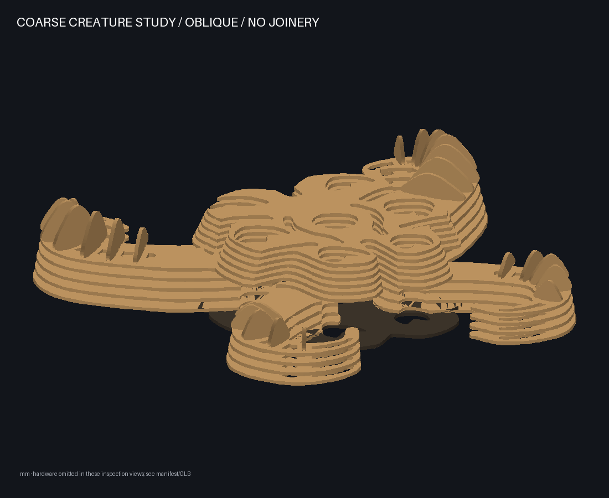
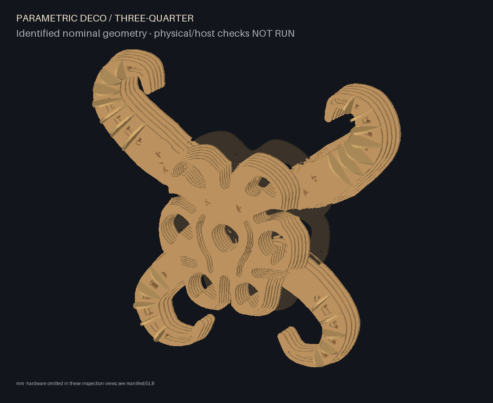

# Ambiguous organism — digital sculpture candidate (v2)

The current revision replaces the literal paired-eye helmet following the user's
visual feedback. Six unequal hooked recesses loosely surround a smaller irregular
opening. There is no solid nose ridge, matching pair of sockets, mouth or helmet
dome. Scalloped shell lobes, cut channels, overlapping layers and four appendages
support competing readings of a creature. It remains a restrained plywood design,
not a copy of the festival installation. No photograph, engraving, random noise,
projection texture or concept painting supplies the physical detail.

## Actual form and critical evaluation

The old radial study repeated similar fins around a large circle. The first mask
revision went too far in the other direction: its two obvious eyes, central ridge
and broad parallel terraces suppressed internal anatomy. This revision keeps the
coherent silhouette but changes the centre and construction of the appendages.

The central shell has six differently shaped/unequal recesses, an
irregular central aperture, channels entering between its outer lobes, and two curved internal channels. Layer
openings enlarge toward the front, exposing stepped cavity walls. The head has no
single dome. Bilateral organisation remains a scaffold, with unequal cavities and
local rib orientation preventing exact mirrored repetition of every detail.

Two dominant crown sweeps and two lower hooks have longitudinal through channels
with intentional bearing bridges. Twenty-four transverse ribs (seven per crown,
five per hook) rise from those bridges. Their width and height grow then diminish
along the curved path; the upper contour leans across each rib. Station placement
uses path distance to avoid crowding keys where the curve tightens. The curled
ends retain broad, rounded plywood contours rather than needle tips.





The front is no longer defined by a nose and two sockets. The centre can still be
read as a face or multi-eyed mask: ambiguity is a visual goal, not a proven metric.
Broad central bridge regions and some repeated layer edges remain visible. The
ribs have much more presence obliquely than in the straight front, where their
6 mm edges are naturally thin. The form is still simpler than the reference;
artistic acceptance depends on inspecting both views, not the test count.

The new three-quarter view is closer to the wall-mounted frontal viewpoint than
the old low oblique. The latter is retained for depth inspection. The lightweight
inspection/viewer pipeline sorts triangles, so overlapping edges can show painter
artifacts; these are not fabricated contour details. Use the identified GLB in a
3D viewer for independent inspection. No new rendering engine was added.

## Construction and accessible assembly

Five coherent modules use laser-cut planar plywood armour, two vertical alignment
webs, plywood spacer-ring compression columns and two root bolts each. All wood
uses one measured thickness, initially 6 mm. The central shell covers limb roots.
Backing has actual cavity openings and staggered mounting holes. Each cut contour
is a connected valid polygon; nominal cuts, holes, slots, counts and IDs export.
The default inventory contains 189 plywood instances (56 definitions).
Default total hardware depth remains 190 mm within the 1000×1000×200 mm envelope.

Each transverse rib has a 28 mm foot through a closed cap slot. Its shoulders bear
on the cap. A headed plywood key passes through a 10 mm by stock-thickness window
in the foot. The cap is four stock thicknesses above the preceding plate, leaving
three thicknesses clear for tabs, keys and clip proxies. Root spacer quantities
increase accordingly. The key's 18 mm head stops it passing through the window;
a 2.5 mm hole at the far end requires a positive split-pin/clip stop. Friction
alone is not accepted as a wall-mounted retention method.

**Twenty-four clips must be selected and prototyped.** The CAD contains clearance
boxes for them, not detailed or approved commercial hardware. Nominal length is
2×stock thickness, below the cap. Actual clip shape, installation, wear/security
and tool clearance are NOT RUN. Real hardware must fit the available gap and stop
reverse key withdrawal; redesign is necessary if a suitable clip cannot do so.

Build cap/rib/key subassemblies upside down on a supported bench before placing
them on the lower stacks. This keeps retaining parts accessible. For service,
remove the complete module, support its lower stack, and lift off the cap/rib
subassembly; invert that subassembly in a cradle to reach the keys/clips. Do not
try to service them blindly through installed shell layers. Exported family
instructions specify the actual IDs, levels and sequence.


The solid cap captures the two root alignment webs. Root bolts clamp the complete
stack and continuous spacer columns to the backing. Detached modules are NOT
self-locking: use a tray/cradle and maintained compression; do not lift by fins or
curl tips. Remove the central shell first, then follow the documented module order.
The older head-root section passes through an alignment web, offset from bolt axes;
it is not a bolt/washer/backing bearing drawing.

## Parameters and honest reuse

Example filenames remain `creature-mask.json` and `creature-mask-raised.json`.
Their current inventory family is **creature-organism-v2**. The earlier v1 helmet
needs **new cuts** for this revision; old inventories are rejected before placement.
Changed armour/web/rib definitions carry new IDs/revisions. Do not infer reuse
from an unchanged semantic module or instance name.

`creature.scale` (.9..1) and `creature.curl` (.8..1.2) change physical contours and
require new cuts. Stock thickness, holes, slot clearance and root drilling do not
scale. Small-envelope or incompatible mounting requests fail rather than shrink.

Within v2, `raised_crown` moves entire crown modules by (−25,+50) and (+25,+50) mm
to compatible grid holes, including every rib/key and clip proxy. Both postures
use the same physical IDs, revisions and manufacturing fingerprints; inventory
mode does not regenerate parts. Crown aperture reliefs clear the cavity channels
in both allowed poses. The raised posture still exposes more root backing and
is a reuse demonstration; the resting posture is the primary artwork.

Unique plates and ribs do not interchange between stations, sides or modules.
Only identical definitions/revisions (retaining keys, spacer rings and compatible
web groups) interchange. Saved templates and manufacturing/layout fingerprints
reject stale revisions, modified definitions, missing/extra physical inventory and
changed manufacturing requests. No claim of arbitrary fin rearrangement is made.



## Build, orbit and projection

```sh
python -m parametric_deco.cli build examples/creature-mask.json --out build/creature-mask
python -m parametric_deco.cli reconfigure examples/creature-mask-raised.json --inventory build/creature-mask/inventory.json --out build/creature-mask-raised
python -m parametric_deco.cli visuals build/creature-mask --out build/creature-mask-visuals --visible-only
python -m parametric_deco.cli visuals build/creature-mask-raised --out build/creature-mask-raised-visuals --visible-only
python -m parametric_deco.cli preview build/creature-mask
```

After installing the project as described in README, run the commands from the
repository root. Open http://127.0.0.1:8765/preview/ to rotate, zoom, identify parts,
hide the backing or separate layers. Explode moves each cap together with its ribs,
retainers and clip proxies, exposing the lower stack. It is an illustration, not
an assembly trajectory. GLB export uses metres, identified meshes and actual parts.

Shared nominal SVG, inventory/assembly JSON, surface IDs, atlases and ISF/Wire
resources remain usable. Visibility samples broad shell faces from (0,0,2000) mm;
rays intersect actual extruded polygons, holes and edges. Finite samples estimate
occlusion; they do not certify illumination or calibrated shadows. Thin blade
edges are not broad frontal projection targets. Broader shell bridges and exposed
terraces remain available for pulses around cavities and along appendages. There
is no new engine, invented Wire patch or Arena preset. Recalibrate after movement.

## Verification boundary

Tests cover connected profiles, unequal cavities/central opening, static solids,
root washer bearing/hardware corridors, register slots/cap capture, rib shoulders,
actual retaining-key window engagement (including a misplaced-key rejection),
cap slot bearing margins, root grids, sampled module extraction, configuration
corners/measured stock, inventory identity/version rejection, exports and atlas IDs.
Removal checks sample every 12 mm through 240 mm; they are not continuous proofs.

Physical fit/finish/wear, rib and cantilever stiffness, column stability, root
preload/fasteners/wall anchors, clip selection/security, tray/cradle handling,
actual tool/finger access and continuous assembly/removal paths remain **NOT RUN**.
Actual browser rendering, Wire/Arena compilation, projector calibration and real
illumination remain **NOT RUN**. Digital success is not fabrication approval.
Run `python scripts/creature_evidence.py` after both builds/atlases to regenerate
the evidence and copy their CAD images into the documentation.
See [generated evidence](creature-mask-evidence.json), [revision record](organism-revision-progress.md)
[single final review](organism-revision-review.md) and [historical v1 record](creature-mask-progress.md).
