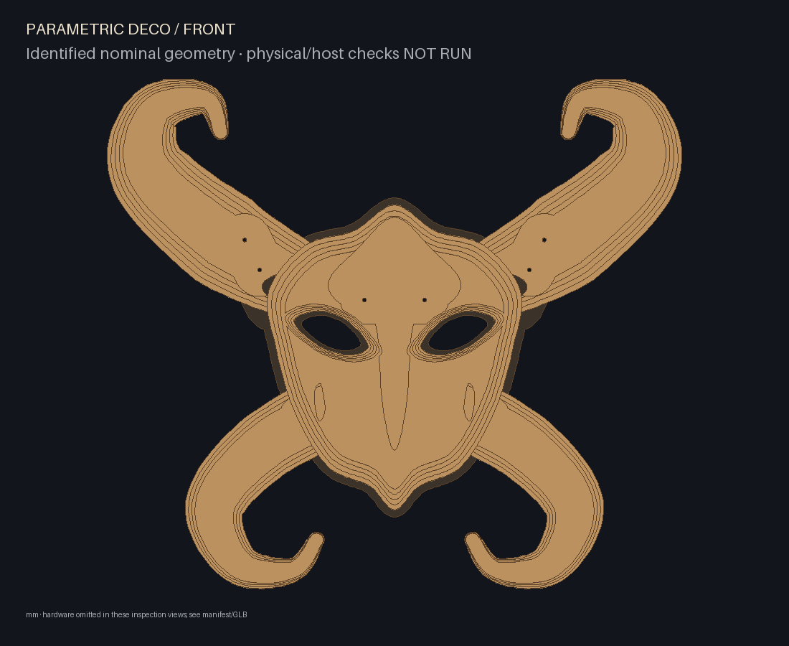
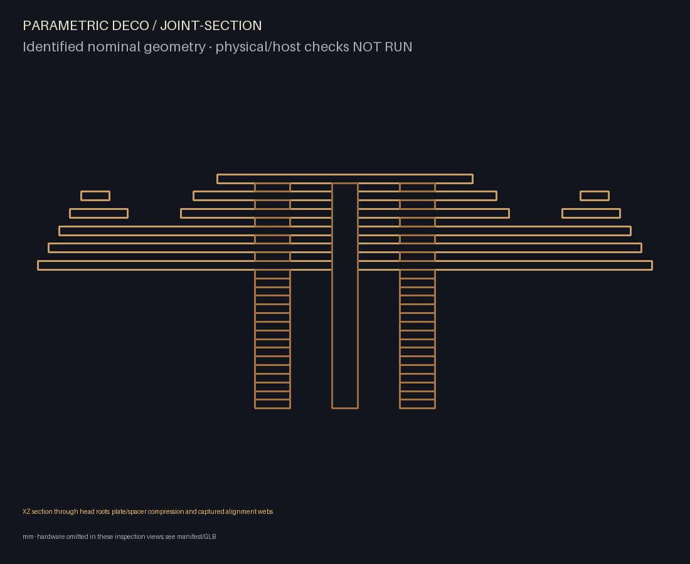

# Creature mask — digital sculpture candidate

This example translates the reference's anatomical principles into a much simpler
alien carapace: two dominant swelling crown sweeps, two subordinate hooked mandibles,
oblique eye cavities, a raised brow/rostrum and two restrained cheek recesses.
No photograph, engraving, random detail, eyeballs, teeth or projection texture is
used to manufacture the presence. The radial weave remains a separate example.

## Visual decisions and critical evaluation

The radial study distributed constant-width rails and similar fins around a large
circle; it lacked a head and a hierarchy. The new composition is bilateral and
centres on the face. Crown widths swell then taper continuously along curved paths;
lamellae narrow through depth and finish with rounded ends at least22 mm wide in
the default crown/mandible profiles. Layering repeats within each organic contour,
not uniformly around a ring. Broad limb roots disappear beneath the head in the
primary front view. The head's raised central plate breaks up the broad face mass.

The coarse study below preceded detailed slots, spacers and mounting. Inspection
removed an overly pictorial mouth and accidental root 'pupils' behind the eyes.
Actual overlapping root contours now clear the common eye channels. The final CAD
views show those real cavities and a stronger focal structure. This is a deliberately
restrained mask, not a miniature copy of the festival installation. The front view
is the primary artistic criterion; the low oblique reveals the shallow layered
construction and long cantilevers. Artistic acceptance still belongs to the user.


## Construction, parameters and reuse

Five modules use planar plywood armour, two vertical slotted alignment webs,
cut-plywood spacer rings and two root bolts each. All wood has one measured
thickness (6 mm default); no hidden solid spacers are omitted. The head is raised
above the crown roots and covers their mechanical boundaries. Slots register plates
in XY; spacers form continuous compression columns; a solid cap obstructs outward
web withdrawal. Root bolts clamp the stack to the backing. This is a different
candidate joint family from the radial mechanism, not inherited validation.

The head-shaped backing has actual eye apertures, a simple staggered hole grid,
and broad hidden shoulders for both mounting postures. Each plate is one valid,
connected planar contour. All profiles, slots, holes and spacer quantities are in
the cut manifest; optional bed layouts fail rather than shrink oversized parts.
Default hardware depth is190 mm within the1000×1000×200 mm envelope.

`creature.scale` (.9..1) changes XY contours; `creature.curl` (.8..1.2) adjusts the
crown-end sweep. Neither scales thickness, holes or clearance. These changes require
new cuts. Envelope and measured-stock settings retain their shared meanings; an
undersized envelope or unavailable grid mount fails validation/build. The family
uses the supplied compatible mounting grid, not arbitrary mounting locations.

`raised_crown` moves the complete crown modules by(−25,+50) and(+25,+50) mm to
other real grid holes. All133 physical IDs and all manufactured fingerprints are
preserved; no parts are regenerated in inventory mode. This is a constrained
second posture, not arbitrary reassembly. It exposes more shoulder channels and
root cutouts and is less seamless than the primary resting artwork.

Unique armour contours do not interchange between levels, sides or modules.
Only identical definitions/revisions, such as spacer rings, genuinely interchange.
Saved authoritative templates and manufacturing/layout fingerprints reject altered
requests, stale revisions, missing/extra physical parts or corrupted station poses.
The request comparison is deliberately conservative about other manufacturing settings.





## Reproduce and project

```sh
python -m parametric_deco.cli build examples/creature-mask.json --out build/creature-mask
python -m parametric_deco.cli reconfigure examples/creature-mask-raised.json --inventory build/creature-mask/inventory.json --out build/creature-mask-raised
python -m parametric_deco.cli visuals build/creature-mask --out build/creature-mask-visuals --visible-only
python -m parametric_deco.cli visuals build/creature-mask-raised --out build/creature-mask-raised-visuals --visible-only
python -m parametric_deco.cli preview build/creature-mask
```

Exports retain the shared nominal SVG, GLB/metres, assembly/inventory IDs, local/world
atlases and ISF sources. No new renderer or invented Wire/Arena preset is included.
The broad-face recommendation selects24 visible armour faces rather than the many
spacer/web/edge surfaces. `projection-visibility.json` samples broad faces from
projector(0,0,2000) mm. Each ray is clipped against the complete extrusion slab and
actual polygon/hole contours of every part, including slots and edges. The finite
sample fraction estimates occlusion; it is not a continuous illumination guarantee.
The tests include both complete occlusion and illumination through a real aperture.

The broader visible forehead, cheek and limb terraces are useful mapping regions;
recess floors and thin edge bands can self-shadow. Existing local/world coordinate
shaders are starting resources for pulses and cavity activity, not an anatomical
arc-length shader. Confirm reachability and calibrate on the physical sculpture.
A future custom renderer can consume the same surface/instance records.

## What is checked and what remains untested

Automated checks cover connected contours, eye channels, finite/ranged config,
measured thickness, static solid interference, slots/web registration, actual cap
obstruction, washer bearing, conservative root hardware corridors, grid mounts,
acyclic sampled whole-module removal, inventory identity and export regressions.
The section passes through a head alignment web and adjacent compression columns.
Front CAD edges are actual contour boundaries; the pictures contain no concept
painting. Exploded offsets identify parts and are not a validated assembly motion.

Remove the head first, then crown/jaw modules in the exported order. Maintain
compression and use a support tray when root bolts are released: the stack is NOT
self-locking off the backing. The generic coupon tests stock slot width only;
prototype actual18 mm web windows and root columns. Detailed family instructions
are exported with both builds. The +Z extraction checks sample every12 mm through
240 mm; they do not certify continuous motion, manual access or every sequence.

Physical fit/finish, long cantilever stiffness, root-column stability under load,
fastener and wall-anchor selection, wear and detached handling remain **NOT RUN**.
Actual browser rendering, Wire/Arena compilation, projector calibration and real
illumination remain **NOT RUN**. A successful digital model is not physical approval.
See [machine-readable evidence](creature-mask-evidence.json) and
[execution/review record](creature-mask-progress.md).
