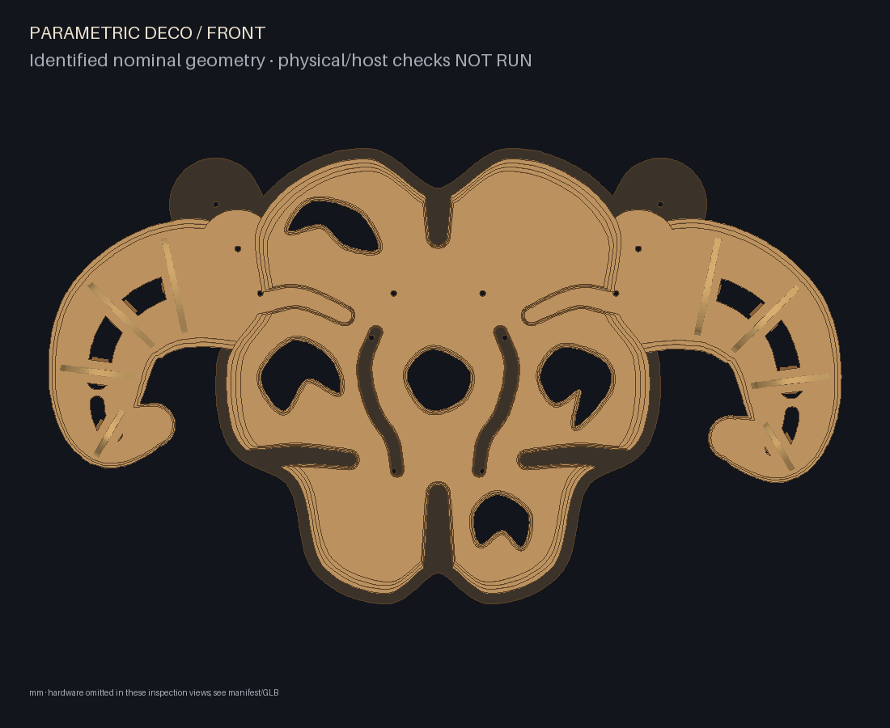
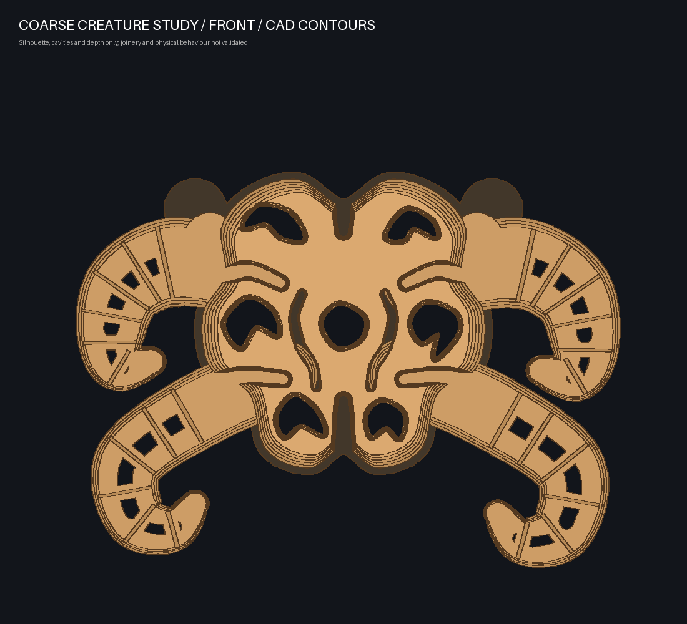
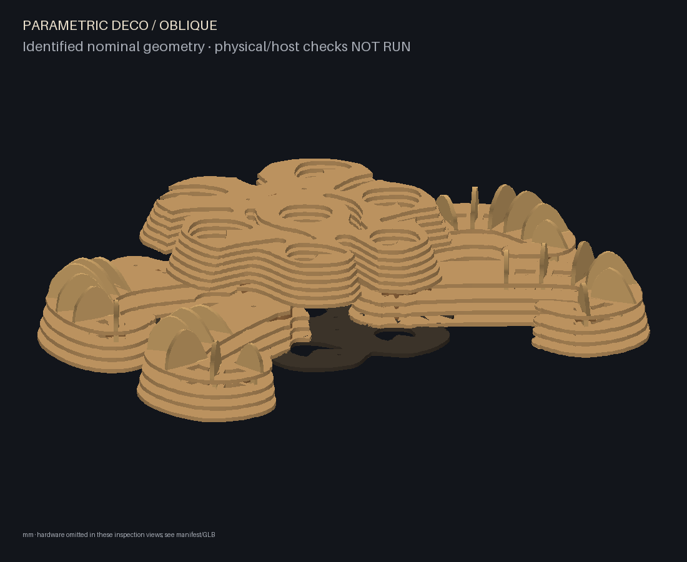
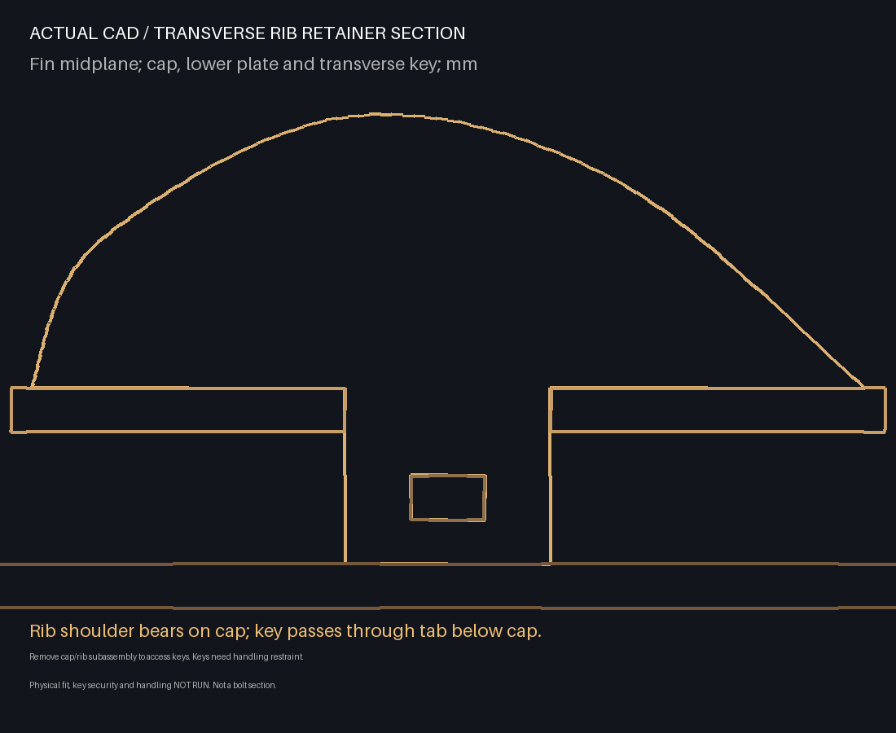

# Legacy parametric alien organism — family v3

Superseded artistically by the [flow organism family](flow-organism.md). Preserved
for regression, comparison and unchanged-inventory rest/raised studies.

This family generates different plywood decos from JSON parameters. It is no
longer a fixed six-cavity mask with two preset horn sweeps. The default has four
limbs sweeping sideways and folding downward/inward, six unequal recesses and a
central irregular aperture. Longitudinal cut channels, transverse ribs and layered
shells provide actual physical anatomy. The radial weave remains a separate example.

`limb_count` counts **all** appendages. It does not add an invisible fixed pair:
2 selects the lateral pair;3 adds one lower grasper;4 adds both graspers;5 adds one
lower sensory limb;6 adds both sensory limbs. Odd counts intentionally break the
bilateral organisation. `asymmetry` varies left/right path reach and width smoothly.
No random noise, engraving or shader is used to create the sculptural detail.

## Parameters

Edit the `creature` object in an example JSON and build to a new output directory.
All controls below affect manufactured contours, part counts or actual rib height.

| Parameter | Default | Supported input range | Physical effect |
| --- | ---: | --- | --- |
| `limb_count` |4| integer2–6 | Active complete appendage modules |
| `cavity_count` |6| integer3–8 | Primary recesses selected from the anatomical cavity palette |
| `ribs_per_limb` |6| integer3–7 | Transverse ribs, cap slots, keys and required clips on EVERY limb |
| `shell_layers` |6| integer3–6 | Central shell plates, root column height and web height |
| `limb_layers` |4| integer3–5 | Shell/rail plates per limb, spacer quantities and cap elevation |
| `limb_reach` |1.0|0.85–1.05| Path reach about fixed mounting roots |
| `limb_width` |1.0|0.9–1.1| Swelling shell/rail widths and rib widths |
| `rib_height_mm` |65|45–80 mm| Peak transverse-rib height, modulated along the limb |
| `asymmetry` |0.08|0–0.15| Controlled side differences in reach/width;0 mirrors the paths |
| `scale` |1.0|0.9–1.0| XY profile AND transverse rib-height scale; roots/stock/joinery retain physical sizes |
| `curl` |1.0|0.8–1.2| Terminal fold position |
| `posture` |`rest`|`rest`, `raised_crown`| Placement of an unchanged manufactured inventory |

Counts reject booleans, strings and fractional floats, including `4.0`. Shape
controls must be finite numbers. Unknown fields fail rather than being ignored.
Existing envelope, material thickness/clearance, mounting and grid controls still
apply. Legacy `module` recipe and polygonal `backplate.sides` settings serve other
families; they do not override this family's organic profiles.

These are **bounded design controls, not a universal topology or fit solver**.
A range-valid combination still must pass actual contour, mounting, bearing,
interference, hardware-envelope and removal checks. For example, increasing reach
and width together can exceed the envelope or crowd adjacent limbs. Invalid
combinations fail with the affected parts; no requested limb/rib is silently
removed, no contour is clipped to fit and plywood thickness is never resized.
The cavity palette and six root/path recipes are explicit current family limits.

## Different designs, different cuts

| Two limbs / four cavities | Four limbs / six cavities (default) |
| --- | --- |
|  |  |


The supplied examples are `creature-alien-two.json`, `creature-mask.json` and
`creature-alien-six.json`. The `creature-mask` filename remains for CLI continuity;
its current geometry is the new four-limb alien composition. Each example is built
from the same generator, not a separately hard-coded model. They require different
cuts and have different part inventories. See the generated evidence JSON for
actual counts, bounds, validation and projection selections.

The original paired upward curls read as helmet horns. The new lateral folds,
unequal reaches, lower graspers and optional sensory limbs change that silhouette.
The central shell can still read as a face; matching paths at asymmetry0 are
intentionally available. Cavity counts select different anatomical openings, not
six matching sockets. Broad central terraces remain a deliberate projection and
construction tradeoff. Artistic success is judged in actual front/oblique views,
not established by a numerical test.




## Construction and inventory

Every wooden part is a connected planar laser-cut profile using one measured
thickness, initially6 mm. A central shell plus `limb_count` complete modules attach
to an organic plywood backing with staggered mounting holes. Each module uses two
root bolts, two slotted alignment webs and continuous plywood spacer-ring columns.
The cap blocks outward root-web withdrawal. Counts, backing root pads, drilling,
web height, spacers, connections and removal order all follow the selected recipe.
Default envelope is1000×1000×200 mm; default maximum hardware Z is190 mm.

Each transverse rib has a28 mm foot through a closed cap slot, with shoulders
bearing on the cap. A headed plywood key crosses a10 mm by stock-thickness tab
window, with manufacturing clearance. Its18 mm head stops forward passage; its
2.5 mm hole requires a positive split-pin/clip stop against reverse withdrawal.
The cap is4t above the preceding plate, leaving3t for the tab/key gap. The key
occupies the middle thickness of this gap. At least7 mm of cap material around
each rib slot is checked before generation. The number of required clips is
`limb_count × ribs_per_limb`, not a fixed24.

Build/service the cap/rib/key subassemblies upside down on a padded support before
placing them on lower stacks. To reach retainers, remove the complete module,
support its lower stack, lift off its cap/rib subassembly and invert it in a cradle.
Do not try blind retaining-key service between mounted layers. Exported family
instructions use the actual generated IDs, levels and quantities.




Clips and root hardware are REQUIRED but remain unselected physical-test items.
Their boxes are clearance proxies, not detailed commercial fasteners or an approved
specification. Clip installation/security, actual tool access and handling are
NOT RUN. Prototype the full joint; change the key/cap or hardware if no suitable
positive stop fits. The generic stock coupon alone does not validate the joint.
Detached stacks are NOT self-locking: maintain tray/cradle support and compression,
and never carry by the fins or tips. Remove the central shell first, then the
exported module order. Sampled +Z removals are not continuous-motion certification.

**Family `creature-organism-v3` requires new cuts compared with v1/v2.** Any count,
reach, width, height, asymmetry, layer, scale, curl, thickness or clearance change
is a new manufacturing request. Existing-inventory mode rejects it. Identical
semantic instance names across different builds do not prove the same part.
Only identical definitions/revisions interchange. Unique ribs and shell profiles
do not swap across stations/sides; identical keys/spacers and compatible webs may.

Within one unchanged v3 manufacture, rest and raised-crown placements reuse every
physical ID, revision and contour. The first lateral pair moves by(−25,+50) and
(+25,+50) mm to real grid holes; all its ribs, keys and clip proxies move with it.
The optional third through sixth limbs remain in place. Raised placement exposes
more backing and is a constrained reuse demonstration, not a new-cut variant.

## Build and inspect

After installation as described in README, from the repository root:

```sh
parametric-deco build examples/creature-mask.json --out build/creature-mask
parametric-deco reconfigure examples/creature-mask-raised.json --inventory build/creature-mask/inventory.json --out build/creature-mask-raised
parametric-deco build examples/creature-alien-two.json --out build/creature-alien-two
parametric-deco build examples/creature-alien-six.json --out build/creature-alien-six
parametric-deco preview build/creature-mask
```

Open http://127.0.0.1:8765/preview/ to orbit, zoom, identify/hide parts or explode.
Each cap moves with its ribs, keys and clip proxies. Offsets illustrate parts;
they are not assembly trajectories. GLB export contains identified meshes in metres.
Front/three-quarter/oblique/side/exploded and actual sections are generated from CAD.
The lightweight renderer sorts triangles and can show overlapping-edge artifacts;
use the GLB in an independent viewer for another inspection.

For each build directory, generate the existing projection resources:

```sh
parametric-deco visuals build/creature-mask --out build/creature-mask-visuals --visible-only
```

Repeat for both variants and the raised build. Then `python scripts/creature_evidence.py`
reloads inventories, checks rest/raised identity, matches atlas IDs and copies the
CAD images/evidence into the docs. No new rendering engine or Wire/Arena preset is
introduced. Visibility samples actual contours/holes from(0,0,2000) mm; broad shell
surfaces are recommended, thin rib edges can self-shadow. Recalibration is required
on real hardware. `clear_aperture_probe_areas_mm2` describes conservative common
clear-passage probes, not full recess-cut areas.

## Verification boundary

Tests cover strict parameter types/ranges, profile/part/module/rib counts, numerical
shape effects, all supported limb counts including odd ones, new-cut rejection for
all controls, obsolete inventory rejection, unchanged-inventory placement, connected
cuts, root mounting/bearing, real key windows/shoulder capture, clearance margins,
static solids, sampled removal, export/atlas identity and preview controls.
Full CLI regressions also preserve legacy/radial examples. See [current execution
and review record](parametric-alien-progress.md) and [generated evidence](creature-mask-evidence.json).
The earlier v1/v2 design/review records are historical.

Physical fit, stiffness/load capacity, wear, root preload/fasteners/wall anchors,
clip selection/security, detached handling, actual tool/finger access and continuous
assembly/removal paths remain **NOT RUN**. Actual browser rendering, Wire/Arena
compilation, projector calibration and illumination remain **NOT RUN**. Digital
geometry success is not fabrication, structural or installation approval.
