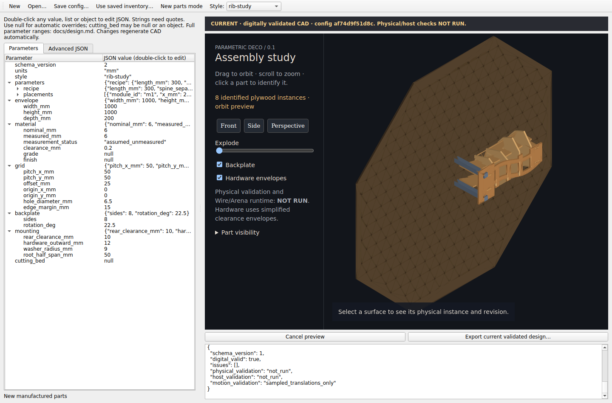

# Python desktop live CAD editor

Install Python 3.11–3.13, create/activate a virtual environment, then install from
the repository root:

```sh
python -m pip install -e ".[gui]"
parametric-deco gui
# Equivalent launcher; optional path opens a schema-v2 configuration:
parametric-deco-gui examples/organism-low.json
```

On Windows use `.venv\Scripts\activate`; on macOS/Linux use
`. .venv/bin/activate`. The optional extra pins PySide6 (including QtWebEngine).
CLI-only installation and commands do not require Qt. Linux needs Qt's usual
platform libraries (including libXtst, libxkbfile, NSS, XComposite, XDamage, XRandR, GBM and
ALSA); a normal desktop session is recommended. No browser, server or network
service is required. The viewer uses the same offline canvas renderer as exports.



Choose any of the four styles. Switching styles replaces its parameter object
with that style's defaults and retains shared settings. Open/Save use schema-v2
JSON; saving a configuration does not export cuts. Parameters shows every key:
double-click a scalar, list or whole object to edit its JSON value. Strings use
quotes; `null` enables automatic overrides. Edit parent lists to add/remove
placements or change list lengths. For example, `cutting_bed` can become
`{"width_mm":1200,"height_mm":800,"spacing_mm":5}` or `null`. The Advanced JSON
tab supports the complete same schema, including optional fields and physical
instance assignments. Return to Parameters to refresh the tree. See
[the design guide](../design.md) for ranges, effects and style boundaries.

Edits automatically debounce for 650 ms, then construct and validate the real
physical geometry in a disposable Python process. CAD may take seconds or minutes.
Status distinguishes waiting/stale, building, invalid configuration, CAD failure,
cancelled and current digitally validated geometry. The last good model remains
visible with an explicit stale status while a new request runs or fails. Drag to
orbit, scroll to zoom, click to identify; front/side/perspective, visibility,
backplate, hardware envelopes and explode controls come from the existing viewer.
Camera, zoom, explode amount, backplate visibility and hardware-envelope visibility
persist across successful regeneration. Per-part visibility resets for each newly
generated scene. Preview
uses the same CAD meshes, instance identities and transforms as CLI exports;
it is not an approximate early mesh. Preview does not write fabrication exports.

Export becomes available only after the current request passes CAD checks. It
captures the normalized config and inventory contents with a SHA-256 fingerprint,
then rebuilds/validates that snapshot and invokes the existing transactional export
pipeline. Editing during export does not change the exported snapshot; the job log
identifies its fingerprint. Export errors retain the previous preview. Existing
output requires confirmation; existing manifest ownership checks still apply.
There is no automatic export. Export completion includes SVG cuts, manifest,
validation, immutable inventory, identified GLB/scene, offline preview, inspection
images and instructions; existing projection/visible-atlas CLI paths remain usable.

“Use saved inventory” loads an immutable inventory snapshot for reconfiguration;
“New parts mode” restores generation. The same inventory compatibility rules as
the CLI apply: existing parts never resize. Mode and inventory path remain visible.
Cancel preview terminates the CAD child process. Closing cancels preview children
and removes session data; while an export commits files, closing waits for its
completion to avoid interrupting replacement. Unsaved config edits prompt before
New, Open or Close. Stock, holes, fit clearances and real hardware never scale with
artwork size. Physical validation and Wire/Arena remain **NOT RUN**.

## Verification

Headless state, nested editing, real CAD worker and camera regressions run in the
normal suite. Optional real Qt/WebEngine integration exercises automatic rebuild,
orbit restoration, invalid/CAD-failed stale states, cancellation, fingerprinted
export during edits, and child cleanup:

```sh
DECO_GUI_TESTS=1 QT_QPA_PLATFORM=offscreen python -m pytest tests/test_desktop_gui.py -q
```

A normal desktop should omit `QT_QPA_PLATFORM=offscreen`. Headless root containers
may require `QTWEBENGINE_DISABLE_SANDBOX=1` and `QTWEBENGINE_CHROMIUM_FLAGS=--disable-gpu`
for testing only; these settings are not enabled by the application. Real screen,
platform integration and physical manufacturing remain separate checks.
