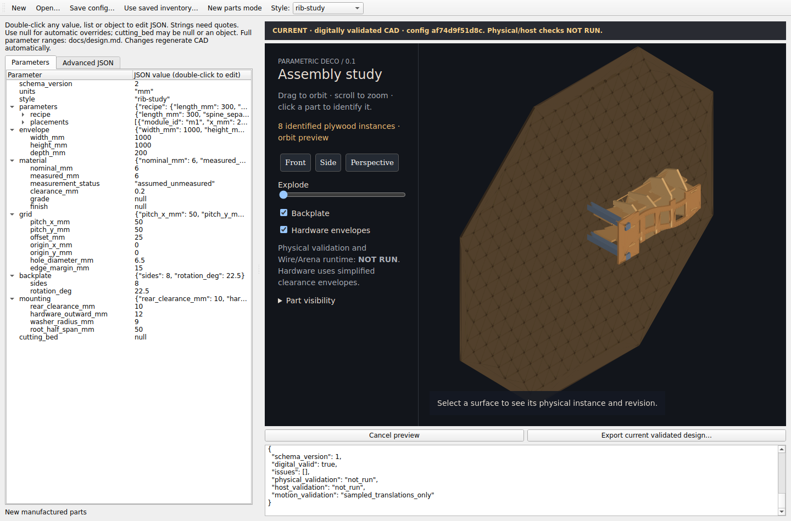

# Python desktop live CAD editor

Install Python 3.11–3.13, create/activate a virtual environment, then install from
the repository root:

```sh
python -m pip install -e ".[gui]"
parametric-deco gui
# Equivalent launcher; optional path opens a schema-v2 configuration:
parametric-deco-gui examples/organism-low.json
```

On Windows use `.venv\Scripts\activate`; on macOS/Linux use
`. .venv/bin/activate`. The same preparation is `scripts/setup-env.ps1` or
`scripts/setup-env.sh`, then `scripts/run-gui.ps1` or `scripts/run-gui.sh`.
Those scripts install the lockfile before the pinned GUI extra so the CAD stack
stays on `requirements.lock`. The optional extra pins PySide6 (including QtWebEngine).
CLI-only installation and commands do not require Qt. Linux needs Qt's usual
platform libraries (including EGL/OpenGL, libXtst, libxkbfile, NSS, XComposite, XDamage, XRandR, GBM and
ALSA); a normal desktop session is recommended. No browser, server or network
service is required. The viewer uses the same offline canvas renderer as exports.



Choose any of the four styles. Switching styles replaces its parameter object
with that style's defaults and retains shared settings. Open/Save use schema-v2
JSON; saving a configuration does not export cuts. Parameters shows every key in
the main window. Edit a value in that table; numbers round or clamp to the
nearest schema-valid value, and the allowed range is shown beside each
parameter. Text can be typed with or without quotes; `null` enables automatic
overrides. Edit a parent list to add or remove placements or change list
lengths. For example, `cutting_bed` can become
`{"width_mm":1200,"height_mm":800,"spacing_mm":5}` or `null`. The Advanced JSON
tab supports the complete same schema, including optional fields and physical
instance assignments. Return to Parameters to refresh the tree. See
[the design guide](../design.md) for ranges, effects and style boundaries.

Edits automatically debounce for 650 ms, then construct and validate the real
physical geometry in a disposable Python process. A progress bar estimates the
remaining time from the style and from earlier builds in the same session, and
moves ahead when construction finishes and meshing or export writing starts.
Status distinguishes waiting/stale, building, invalid configuration, CAD failure,
cancelled and current geometry. The last good model remains
visible with an explicit stale status while a new request runs or fails. Drag to
orbit, scroll to zoom, click to identify; front/side/perspective, visibility,
backplate, hardware envelopes and explode controls come from the existing viewer.
Camera, zoom, explode amount, backplate visibility and hardware-envelope visibility
persist across successful regeneration. Per-part visibility resets for each newly
generated scene. Preview
uses the same CAD meshes, instance identities and transforms as CLI exports;
it is not an approximate early mesh. Preview does not write fabrication exports.

Export becomes available only after the current request passes CAD checks. It
captures the normalized config and inventory contents with a SHA-256 fingerprint,
then rebuilds/validates that snapshot and invokes the existing transactional export
pipeline. Editing during export does not change the exported snapshot; the job log
identifies its fingerprint. Export errors retain the previous preview. Existing
output requires confirmation; existing manifest ownership checks still apply.
There is no automatic export. Export completion includes SVG cuts, manifest,
validation, immutable inventory, identified GLB/scene, offline preview, inspection
images and instructions; existing projection/visible-atlas CLI paths remain usable.

“Use saved inventory” loads an immutable inventory snapshot for reconfiguration;
“New parts mode” restores generation. The same inventory compatibility rules as
the CLI apply: existing parts never resize. Mode and inventory path remain visible.
Cancel preview terminates the CAD child process. Closing cancels preview children
and removes session data; while an export commits files, closing waits for its
completion to avoid interrupting replacement. Unsaved config edits prompt before
New, Open or Close. Stock, holes, fit clearances and real hardware never scale with
artwork size.

## Verification

Headless state, nested editing, real CAD worker and camera regressions run in the
normal suite. Optional real Qt/WebEngine integration exercises automatic rebuild,
orbit restoration, invalid/CAD-failed stale states, cancellation, fingerprinted
export during edits, and child cleanup:

```sh
DECO_GUI_TESTS=1 QT_QPA_PLATFORM=offscreen python -m pytest tests/test_desktop_gui.py -q
```

A normal desktop should omit `QT_QPA_PLATFORM=offscreen`. Headless root containers
may require `QTWEBENGINE_DISABLE_SANDBOX=1` and `QTWEBENGINE_CHROMIUM_FLAGS=--disable-gpu`
for testing only; these settings are not enabled by the application. Real screen,
platform integration and physical manufacturing remain separate checks.

## Typed controls and live projection content

Finite parameter choices use dropdowns: styles, arrangements, symmetry, posture,
booleans, supported voltages and small integer ranges. Optional integer overrides
include **Automatic (null)**. Compound lists and objects retain JSON editing.

The **Projection** tab controls pulse, radial rings, checker and solid content.
Coordinates are cross-part path, local U/V, normalized world X/Y/Z and radial
distance. Settings include signed speed, phase, repeats, pulse width, softness,
edge masking/width, RGBA foreground/background and brightness. Colors are four
numbers in 0..1. Enable projection to show the content on actual selected faces;
orbit, zoom and picking remain available. The viewer's show and play/pause buttons
change the preview. Saved content settings are edited in the Projection tab.

The WebGL renderer and exported ISF use the same GLSL function. Meshes and data
textures upload once per scene; animation updates GPU uniforms. Content edits do
not rebuild CAD, reload the page or reset the camera. Atlas dimensions and face
selection repack in a worker from the last validated assembly, without CAD
construction. Static assembly viewing remains available without WebGL.

Settings live in the optional schema-v2 `projection` object. Older requests use
defaults. They do not change manufactured part identity or saved inventory.
Full exports include `projection/projection.json`, `projection/projection.fs`,
data images, `projection-selection.json` and the configured viewer. Existing
calibration and edge pulse shaders are retained. `broad` selects broad faces;
`exterior` adds outer cut walls; `all` adds inner cut walls. Atlas dimensions
support the same integer 16..8192 range as the visuals command.

If the atlas cannot hold the selected faces plus gutters, the GUI reports this
separately. Valid CAD and cutting exports remain usable. The export includes the
requested settings and `projection/error.json`; increase the atlas dimensions or
reduce the selected faces to generate projection assets. Atlas retries reuse the
validated assembly. Projection errors do not change CAD validation results.

```json
{
  "style": "laminar",
  "projection": {
    "enabled": true,
    "effect": "rings",
    "speed": -0.15,
    "repeats": 8,
    "width": 0.3,
    "color": [0.2, 0.7, 1.0, 1.0]
  }
}
```

The integration tests check real Qt controls, live content edits, framebuffer
colors, no CAD rebuild for projection edits, and recovery from atlas failures.
For a Linux headless OpenGL check, install Xvfb, Mesa and Qt xcb libraries, then:

```sh
DECO_GUI_TESTS=1 DECO_REQUIRE_WEBGL=1 QT_QPA_PLATFORM=xcb LIBGL_ALWAYS_SOFTWARE=1 \
  QTWEBENGINE_CHROMIUM_FLAGS="--use-gl=angle --use-angle=gl --ignore-gpu-blocklist --disable-gpu-compositing" \
  xvfb-run -a python -m pytest tests/test_desktop_gui.py -q
```

Offscreen static GUI checks can run without WebGL; the animation check skips
unless an OpenGL context is available. `DECO_REQUIRE_WEBGL=1` makes missing WebGL
an error, as in CI.
