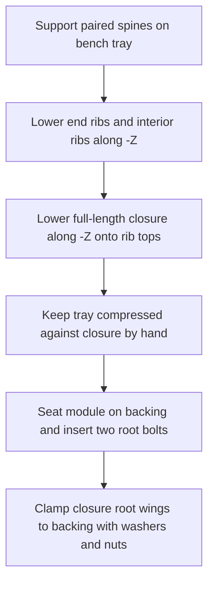

# Candidate backplate-clamped closure

The joint profiles below remain the source placement-template design. Its root-only mounting description is historical; the current manufactured revision adds separated universal-grid end clamps and rigid tubes. Follow [current mounting](mounting.md) and exported mounting-hardware.json, including removal of every end clamp before the sequence below.

All coordinates here are module-local, millimetres. X runs along the module,
Y across it, Z away from the backing. Every wooden part is nominal 6 mm.

## Sections and assembly states (design before implementation)

Two planar XZ spines sit at Y=-30 and +30. Their bodies reach Z=80;
slots open upward at each X station and finish at Z=45. Each transverse
YZ rib spans Z=10..116; its two complementary slots open downward and
finish at Z=45. Slots are measured thickness + total fit clearance wide.
Thus final sections alternate material at the common Z=45 datum, with
clearance across the mating thickness and no positive-volume overlap.
Rib profiles vary only outside the common joint-bearing region.

The closure is a real horizontal XY plywood plate at Z=116..122. It
covers the central region of **every** rib, rather than a short root cap
which cannot retain distal ribs. Two spine end tongues extend to Z=122
through closed clearance slots in the closure, locating it in XY. The
root wings contain two through-holes at (0,-50) and (0,+50). Long root
bolts run in Z through closure and backing. There are no individual rib
fasteners. Lower spine edges bear on the backplate at Z=0; ribs stop at
Z=10 to leave wood below the spine slot datum.

The upper closure blocks rib +Z extraction immediately. The spine slots
block rib ±X; the paired rib slots block ±Y and constrain rotation.
The backplate blocks spine -Z and root bolts retain closure +Z. End ribs
brace the spine pair. Closed closure slots limit relative XY motion.
This is a sampled translational restraint candidate, **not a proof of all
six-degree-of-freedom escape motions or structural adequacy**.

Two root washers and nuts are outside the spine pair (Y=±50, X=0);
the first rib station starts at X=70, leaving a front wrench corridor.
Rear nuts need 10 mm clearance behind the 6 mm backing (or bench access).
Hardware envelopes include 9 mm washer radius and 12 mm outward allowance.
Bolt length, grade, wall anchors and load capacity must be chosen by the
builder. These long bolts replace the earlier *short flange* intuition;
this avoids pretending an unretained tongue is a cantilever root lock.

## Removal and reconfiguration

1. Support the module from below with a tray reaching the spine bottom
   edges. Press the closure onto ribs with the other hand/helper.
2. Remove both root fasteners while keeping the sandwich compressed.
3. Translate the entire module along +Z at least its depth, retaining
   compression. Do not carry the unbolted assembly by the closure alone.
4. Set the tray on a bench. Lift closure along +Z past the 6 mm tongues.
5. Lift ribs along +Z until their downward slots clear the spines.
6. Move compatible ribs to documented unoccupied stations, rebuild,
   refit closure and repeat the supported mounting sequence.

Detached modules are **not self-locking**. Tray/hand compression is a
required handling step. Independent module extraction is sampled against
neighbours and reported with the assembly; blocked paths require removing
the blocking module first. Arbitrary rotations during extraction are not
verified. Fit, wear, stiffness, bolt preload, tool access and tray handling
are physical tests marked NOT RUN.
