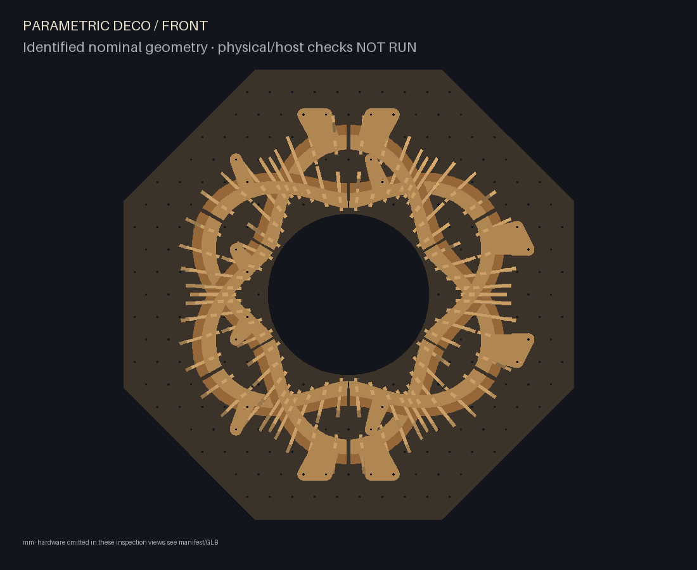
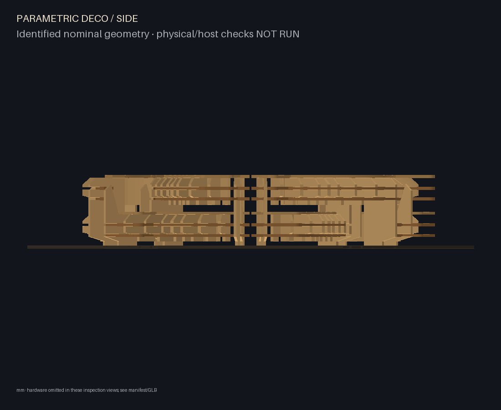
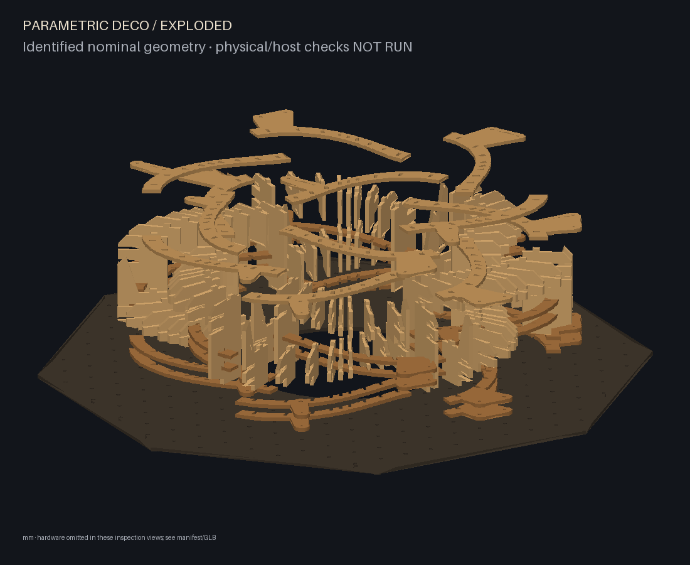
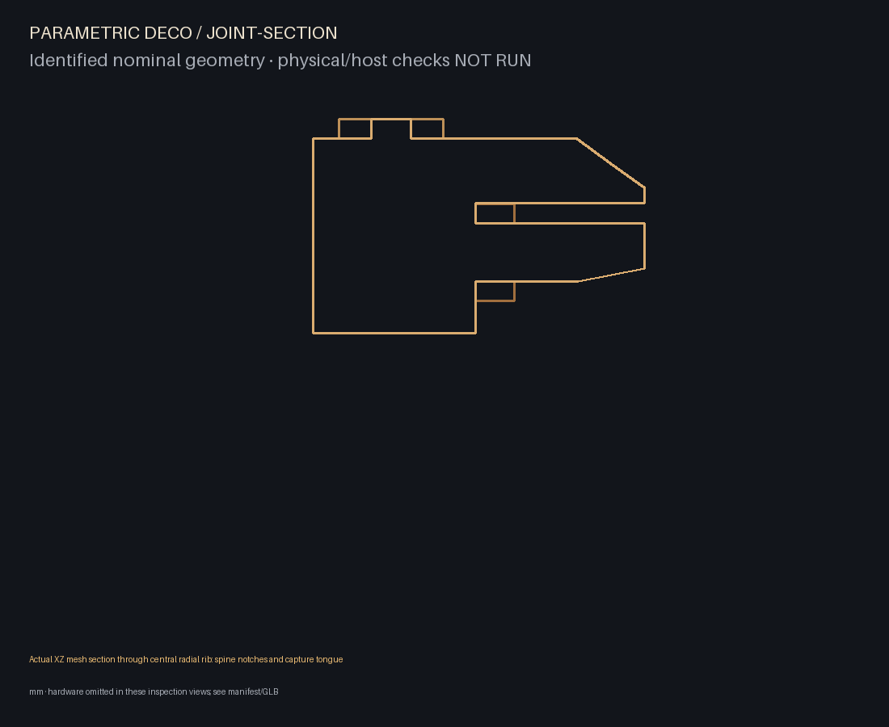
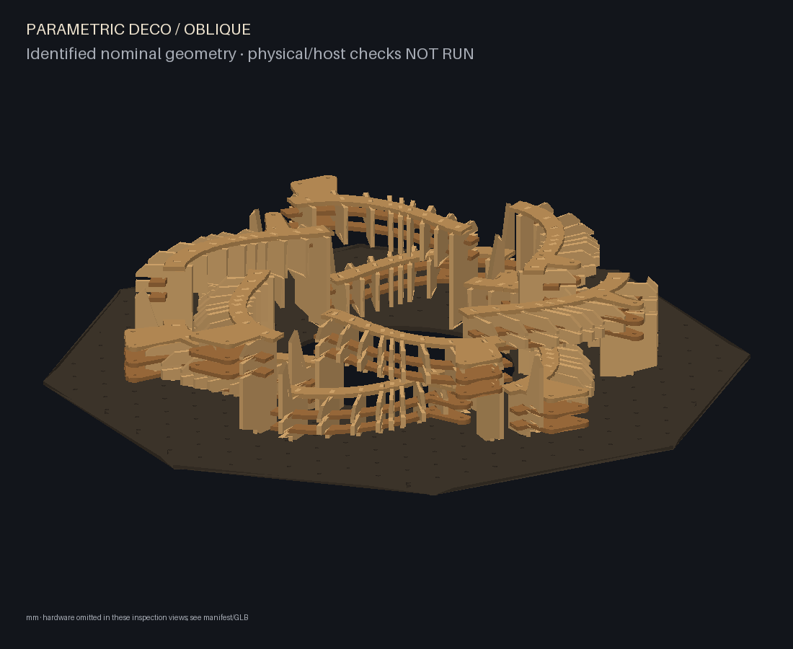

# Radial weave digital artwork

The approved direction is a pronounced opening surrounded by dense, sweeping
ribbed forms with clear alternating crossings. `examples/radial-weave.json`
introduces a separate curved family; the old four-module mechanical study remains
available as `examples/intertwined.json`.

Two annular paths follow R = 300 ± 65 sin(3θ) mm. Six crossings occur at 60-degree
intervals. Each path alternates high and low, producing twelve removable curved
modules, 108 radial fins, 24 curved spines and twelve capture rails. The octagonal
backing has a real 360 mm central aperture. No manufactured contour may enter it.
The default overall wall-relative depth, including hardware proxies, is 186 mm.

Each fin is a planar vertical radial contour. Two horizontal curved spines use
open perpendicular slots; the upper horizontal rail uses closed windows around
fin tongues. With the rail removed, fins slide inward for removal. With it
installed, the first millimetre of that motion is obstructed by actual material.
This is a new joint candidate, with no inherited physical validation from the
straight family. See the generated family-specific assembly instructions.

The staggered backing grid remains authoritative. Each root searches one arc end
and tries the other if the first cannot supply two clear holes. Washer disks must
fit both slotted spine and rail contours; the entire bolt corridor must clear all
fins and other module plates. Broad search pads are then trimmed around the chosen
pair and their material bridges. Each module needs two root bolts. Hardware is a
conservative envelope, not a fastener design or load calculation.

## Reproduce

```sh
python -m parametric_deco.cli build examples/radial-weave.json --out build/radial-weave
python -m parametric_deco.cli reconfigure examples/radial-weave-reconfigured.json --inventory build/radial-weave/inventory.json --out build/radial-weave-reconfigured
python -m parametric_deco.cli visuals build/radial-weave --out build/radial-weave-visuals --width 4096 --height 4096
python -m parametric_deco.cli visuals build/radial-weave-reconfigured --out build/radial-weave-reconfigured-visuals --width 4096 --height 4096
python -m parametric_deco.cli preview build/radial-weave
```

The second arrangement rotates placement by 180 degrees and cycles compatible
central fins among stations 2–6. It is a modest rearrangement of the same braid,
not a claim of a second independently composed artwork. All physical IDs and
manufactured fingerprints remain unchanged. Saved inventory includes authoritative
station transforms and a checked layout fingerprint. Changed stock, grid, backing,
root geometry, radius or amplitude requests require new manufactured inventory;
existing-inventory mode does not regenerate cut parts.

## Evidence and limits

Generated `assembly.json` and `manifest.json` include composition metadata:
opening clearance, exact crossing roles, central crossing clearances, sampled
extraction dependencies and a removal order. Static collisions use real solids;
parallel horizontal plate intersections use the equivalent exact prism calculation.
Conservative XY projections reject pairs that cannot intersect before kernel checks.
Low modules require their corresponding high module to be removed first. Positive-Z
module extraction is sampled every 10 mm through 240 mm; radial bench paths are
sampled at 0, 10, 40 and 80 mm. These are bounded checks, not a complete motion proof.

Inspection views are generated directly from CAD, not image-generation artwork.
Front, oblique, side, exploded and central radial XZ section views are provided.
The section passes through the central fin of module a0. Hardware is omitted from
PNG views and represented by labelled envelopes in the GLB/scene manifest.

Physical joint fit, strength, rail handling, root bolt/spacer specification,
backing stiffness around the opening and wall anchorage remain **NOT RUN**.
Wire/Arena shader compilation, projector calibration and actual browser rendering
remain **NOT RUN**. The digital artwork candidate does not complete those gates.







